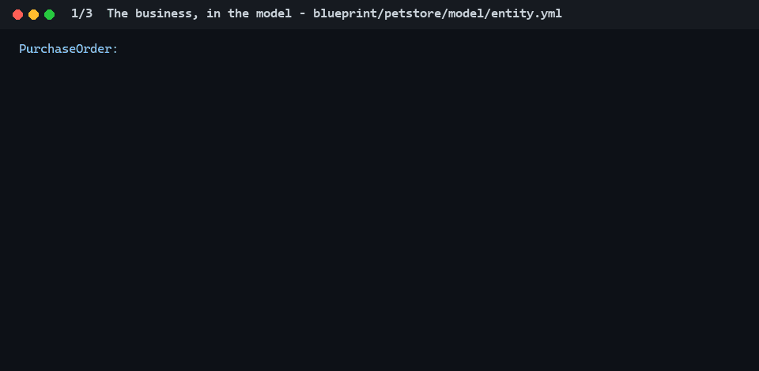

<p align="right"><a href="README.md">English</a> · <b>한국어</b></p>

# ElastiCORE

[](https://central.sonatype.com/artifact/io.elasticore/elasticore-base)
[](https://openjdk.java.net/)
[](https://spring.io/projects/spring-boot)
[](LICENSE)

**Spring Boot 애플리케이션의 업무 규칙(누가 무엇을 하는지, 주문이 어떻게 진행되는지, 값이 어떻게 정해지는지)을
YAML 로 적으면, ElastiCORE 가 그 규칙을 지키게 하는 코드를 생성합니다 - 모든 진입점에서, 매번 똑같이.**



<sub>이 저장소의 pet store 예제입니다. 실제 모델, 생성기의 실제 출력, 서버의 실제 응답을 한 줄씩으로 줄였습니다.</sub>

- **코드가 아니라 규칙을 리뷰합니다.** 위에서 새 단계는 DSL 2줄이고, 생성된 Java 는 7개 파일에서 45줄이 바뀝니다.
  개발자나 AI 도구는 2줄을 쓰고, 리뷰어도 2줄을 읽습니다.
- **규칙이 모든 진입점에서 지켜집니다.** 권한, 소유, 생명주기, 파생 값, 검증이 모델의 한 줄이고, 규칙을 어긴 요청은
  오류 코드와 함께 정해진 응답(401, 403, 409, 400)을 받습니다.
- **다시 생성해도 안전합니다.** 모델의 몫과 개발자의 몫이 다른 파일이고, 손으로 고친 파일은 덮어쓰지 않습니다. 그래서
  변경은 언제나 모델에서 하고, 코드가 모델과 어긋나지 않습니다.
- **모델 하나에서 원하는 코드로.** Java 나 Kotlin, 레이어드·DDD·헥사고날, Spring Boot 3 이나 4, 그리고 서버와 같은
  검증 문구를 가진 TypeScript 클라이언트.

**이런 시스템을 위해 만들었습니다**: 주문, 정산, 계약, 백오피스처럼 여러 사람의 손을 거치며 몇 년씩 운영되는 업무
시스템. 화면이 대부분인 애플리케이션, 영속이 관계형이나 JPA 가 아닌 시스템, 선언형 모델로 나타내기 어려운 로직에는
적합하지 않습니다. JHipster, Spring Modulith, Context Mapper, Jmix 등과의 비교: [비교 문서](docs/comparison.ko.md).

## 돌려 보기

```bash
git clone https://github.com/xsko/ElastiCORE.git && cd ElastiCORE
./gradlew :elasticore-project:elasticore-sample-petstore:run      # JDK 17~22
```

<http://localhost:8080> 을 열면 로그인(`user`/`user`, `admin`/`admin`), 장바구니, 주문이 있는 pet store 가 뜹니다.
서버는 [YAML 162줄](elasticore-project/elasticore-sample-petstore/src/main/resources/blueprint/petstore/model/)에서
생성되고, 손으로 쓴 것은 주문 접수(부가세, 할인, 주문일), 회원 가입, 데모 계정입니다 - 7개 클래스, 주석 포함 269줄.
`/dsl-guide.html` 은 업무마다 DSL 한 줄과 그 줄이 만든 코드를 나란히 보여 줍니다.

## 5단계로 내 프로젝트에

**① `build.gradle`** - Spring Boot 프로젝트에 플러그인과 설정 두 줄, 그리고 생성된 코드가 쓰는 의존성

```gradle
plugins {
    id 'java'
    id 'org.springframework.boot' version '4.0.8'      // 3.x 도 됩니다 - 버전을 읽어 맞춰 생성
    id 'io.spring.dependency-management' version '1.1.7'
    id 'io.elasticore' version '3.0.261022-rc1'
}

repositories {
    mavenCentral()
}

elasticore {
    architecture = 'hexagonal'    // layered | ddd | hexagonal
    language     = 'java'         // java | kotlin
}

dependencies {
    implementation 'io.elasticore:elasticore-base:3.0.261022-rc1'
    implementation 'io.elasticore.springboot4:elasticore-springboot4:3.0.261022-rc1'

    implementation 'org.springframework.boot:spring-boot-starter-webmvc'
    implementation 'org.springframework.boot:spring-boot-starter-data-jpa'
    implementation 'org.springframework.boot:spring-boot-starter-validation'
    implementation 'org.springdoc:springdoc-openapi-starter-webmvc-ui:3.0.3'
    compileOnly 'org.projectlombok:lombok'
    annotationProcessor 'org.projectlombok:lombok'
    runtimeOnly 'com.h2database:h2'               // 바로 실행해 볼 메모리 DB
}
```

플러그인도 Maven Central 에 있으니 `settings.gradle` 에 플러그인 저장소로 적습니다:
`pluginManagement { repositories { mavenCentral(); gradlePluginPortal() } }`. Java 17 이상, Spring Boot 4 이면
Gradle 8.14 이상입니다. Spring Initializr 로 시작했거나 Spring Boot 3 이면: [시작하기](docs/getting-started.ko.md).

**② `src/main/resources/blueprint/shop/`** - 도메인 설정과 업무를 적습니다

```yaml
# env.yml
elasticore:
  enable: true
  config:
    domainName: shop
    framework: springboot
    mode: jpa
    j2ee: jakarta
    apiPath: "/api"               # REST 주소: /api/shop/...
  namespace:
    base: com.acme.shop           # 패키지 구조는 이것 하나로
```

```yaml
# model/entity.yml
entity:
  Product:
    meta: entity @root @editable @expose(20) @access(read=public) @sort(name+) -- 상품
    fields:
      productId: long @id @sequence
      name:      string(100)! @search(like)
      price:     money(10.2)! @min(0.01, 'price must be positive')
```

**③ 생성** - `./gradlew elcore3`. `src/main/java/com/acme/shop/` 아래에 이런 것이 생깁니다:

```
domain/model/Product.java               JPA 엔티티
application/ProductCoreService.java     CRUD·검색·권한 검사 (다시 생성됨)
application/ProductService.java         내 코드를 쓰는 곳 (한 번만 생성, 그 뒤로 내 파일)
application/dto/ProductDTO.java         요청·응답 (+ 400 검증)
application/dto/ProductSrchDTO.java     검색 조건 - 이름 LIKE, 페이지, 정렬 (요청이 말하지 않으면 이름순)
adapter/in/web/ProductController.java   REST API + OpenAPI 문서 (이것도 한 번만 생성)
domain/repository/...                   리포지터리 포트
infrastructure/persistence/...          그 JPA 어댑터
```

**④ 내 작업** - `com.acme.shop` 이나 그 위 패키지에 `@SpringBootApplication` 클래스, `ProductService.java` 에 업무
로직, 그리고 로그인: 상품을 바꾸려면 `ADMIN` 역할이 필요하니 로그인 처리에서
`SessionCurrentUser.signIn(request, userId, "ADMIN")` 을 부릅니다(패키지는 Boot 4 에서도
`io.elasticore.springboot3.security`). Spring Security 를 쓰면 대신 `CurrentUser` 빈을 등록합니다.

**⑤ 실행** - `./gradlew bootRun`. 상품 검색·조회는 누구나 할 수 있고, 로그인 없이 상품을 만들면 401 "Sign in to
create Product", 가격 0 은 400 "price must be positive" 로 답합니다. `build` 와 `bootRun` 은 `elcore3` 를 먼저
돌리므로, 이제부터 변경은 모델에서 시작합니다.

## 모델에 담는 것

| 업무 정보 | DSL |
|---|---|
| 필드: 저장·검증·검색·노출 | `name: string(100)! @search(like)` - 한 줄이 한 필드 |
| 권한·소유 | `@access(read=owner, create=user)`, `@owner(customerId)` |
| 로그인·비밀번호 | `@signin`, `@login`, `@password` (PBKDF2 해시, 응답·검색에서 제외) |
| 생명주기 | `states:` - `ship: PLACED -> SHIPPED`, 지울 수 있는 상태, 화면용 `canShip(dto)` |
| 파생 값 | `@snapshot(item.unitCost)`, `@compute(unitCost * quantity)` |
| 업무 지표·용어 | `metrics:` - `revenue: sum(PurchaseOrder.total) where status != CANCELLED`, `@terms` |
| 도메인 경계 | `context: uses / publishes` - 아무도 열지 않은 경계를 넘는 참조는 빌드가 거절 |
| 외부 연결 | `port:` - HTTP·SQL·gRPC 를 인터페이스로 선언 |
| 우리 팀 규칙 | `@Rule` 메서드를 가진 Java 클래스 - 기본 규칙처럼 생성에 끼워짐 |

같은 모델을 설정 한 줄로 다르게 읽습니다: `language = 'kotlin'`, `architecture = 'ddd'`, Spring Boot 플러그인 버전,
TypeScript 클라이언트는 `./gradlew elcore3ts`, 일부 규칙만 쓰려면 `env.yml` 에
`publisher: rules: [jpa-springboot-kt, ddd-aggregate, …]`. 데이터의 의미도
[Apache Ossie](https://github.com/apache/ossie) 의미 모델로 내보내 BI 도구와 AI 에이전트가 읽게 합니다.

**[둘러보기](docs/tour.ko.md)** 에서 하나하나를 생성된 코드, 실제 요청과 함께 자세히 봅니다.

## 현재 상태

**3.0 은 정식 출시 전(pre-release)입니다** ([Maven Central](https://central.sonatype.com/artifact/io.elasticore/elasticore-base)).
`architecture`·`language`·`rules` 를 적지 않은 프로젝트는 이력에 적은 버그 수정과 Spring Boot 4 에서 Jackson 3 에
맞춘 enum 을 빼면 2.x 가 만들던 코드를 받습니다: 풀 리퀘스트마다 2.x 생성기가 만든 기준 프로젝트는 커밋된 그대로여야
하고, 규칙 엔진의 `jpa-springboot` 번들은 그 출력과 파일마다 비교됩니다 ([자세히](docs/tour.ko.md#현재-상태)). 매 빌드에서 자동 테스트 1,400개 이상이 돌고, 예제 프로젝트들은 생성·컴파일·실행까지 합니다. v3 번들의
출력은 정식 출시 전까지 바뀔 수 있고, 바뀔 때마다 그 이유를
[이력](elasticore-project/elasticore-base/src/main/resources/elasticore-guide/elasticore-history.md)에 적습니다.
3.0 은 첫 정식 릴리스부터 3년간 지원합니다 ([SECURITY.md](SECURITY.md), [BRANCHING.md](BRANCHING.md)).

## 문서

| 문서 | 내용 |
|---|---|
| [시작하기](docs/getting-started.ko.md) | Spring Initializr, Spring Boot 3, 소스에서 빌드 |
| [둘러보기](docs/tour.ko.md) | DSL 의 여섯 원칙, 업무 규칙, 규칙(ruleset), 바운디드 컨텍스트, 무엇을 검사하는지 |
| [다른 도구와 비교](docs/comparison.ko.md) | JHipster, Context Mapper, Sculptor, Spring Modulith, Amplication, Jmix, Wasp, Bootify, AI 가 Spring 을 직접 쓰는 것과 비교 |
| [DSL](elasticore-project/elasticore-base/src/main/resources/elasticore-guide/elasticore-dsl-guide.md) | 엔티티, DTO, enum, 생명주기, 업무 지표, 값 타입 |
| [어노테이션](elasticore-project/elasticore-base/src/main/resources/elasticore-guide/elasticore-annotation-guide.md) | 모든 어노테이션과 생성 결과 |
| [설정](elasticore-project/elasticore-base/src/main/resources/elasticore-guide/elasticore-env-guide.md) | `env.yml`, 바운디드 컨텍스트, 멀티 모듈, Spring Boot 3/4 |
| [규칙 엔진](elasticore-project/elasticore-base/src/main/resources/elasticore-guide/elasticore-rule-guide.md) | 구조 고르기, 규칙 묶음, 오류 코드와 다국어, Ossie 내보내기 |
| [규칙 개발](elasticore-project/elasticore-base/src/main/resources/elasticore-guide/elasticore-rule-dev-guide.md) | 우리 팀 규칙 만들기, 테스트 |
| [포트](elasticore-project/elasticore-base/src/main/resources/elasticore-guide/elasticore-dsl-port-guide.md) | HTTP, DB, gRPC 포트 |

가이드는 빌드할 때마다 프로젝트의 `blueprint/` 로 복사되므로, AI 도구는 지금 쓰는 버전의 문법을 그대로 읽습니다
(한국어, 영문판 준비 중).

## 참여하기 · 라이선스

[CONTRIBUTING.md](CONTRIBUTING.md) · [행동 강령](CODE_OF_CONDUCT.md) · [보안 신고](SECURITY.md) · Apache License 2.0 ([LICENSE](LICENSE))
