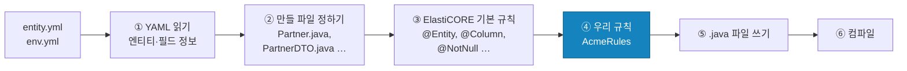
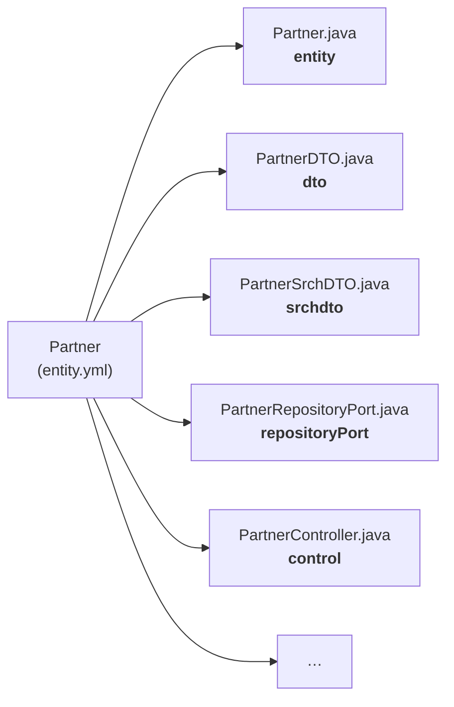
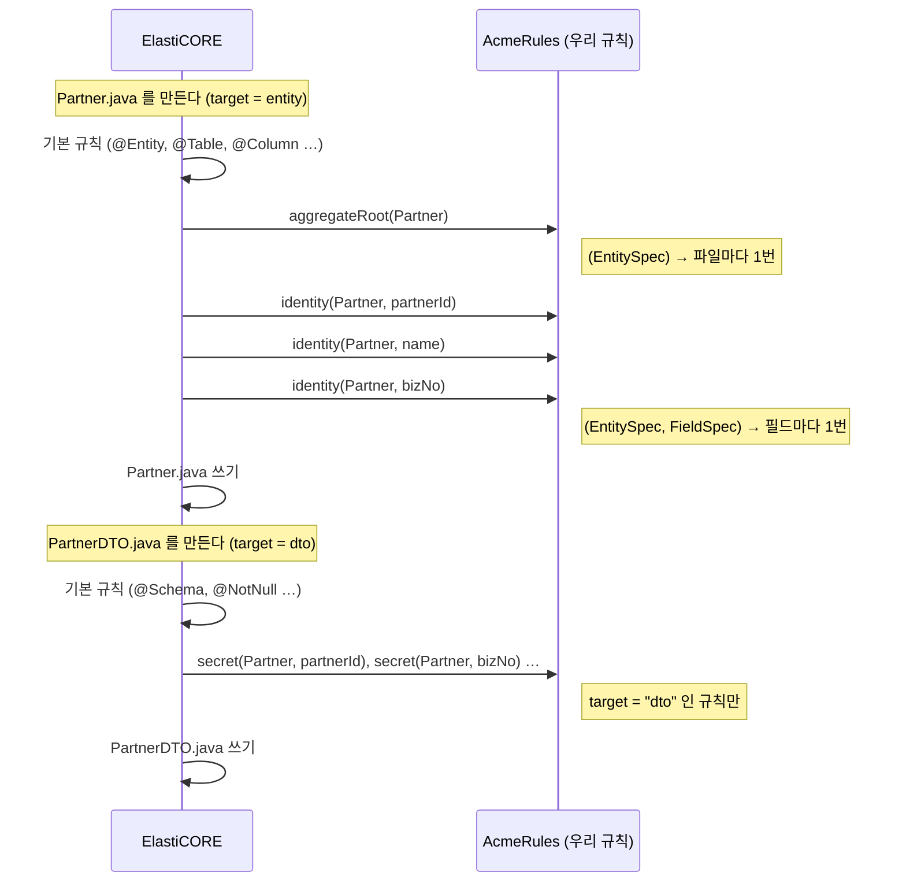
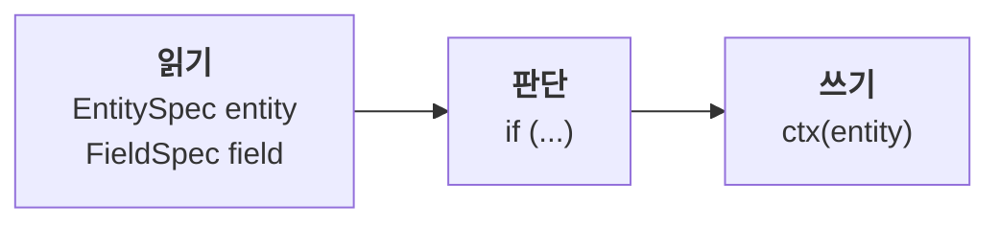
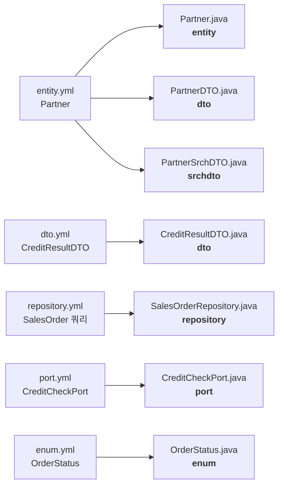

# ElastiCORE 규칙 개발 가이드

ElastiCORE는 YAML(DSL)을 읽어 엔티티, DTO, 서비스, 컨트롤러 코드를 만들어 줍니다.
그런데 회사마다 원하는 것이 있습니다. "모든 엔티티에 우리 어노테이션을 붙이고 싶다", "특정 필드는 응답에 나가면 안 된다" 같은 것들입니다.

생성된 파일을 매번 손으로 고치면 다음 생성 때 사라집니다. 대신 **규칙(rule)** 을 하나 만들어 두면, ElastiCORE가 코드를 만들 때마다 그 규칙을 적용합니다.
규칙은 평범한 Java 클래스이고, 메서드 하나가 규칙 하나입니다.

이 문서는 헥사고날 ERP 예제 프로젝트(Partner, Item, SalesOrder …)에 규칙을 더해 가며 설명합니다. 예제의 모든 코드는 실제로 빌드하고 테스트했습니다.

| 장 | 무엇을 배우나 | 결과 |
|---|---|---|
| 0 | 규칙이 언제, 어디서 동작하나 (그림) | 전체 흐름과 내 코드가 끼어드는 자리를 이해 |
| 1 | 규칙을 둘 곳 만들기 | 빌드할 때 우리 규칙이 실행됨 |
| 2 | 클래스에 어노테이션 붙이기 | 루트 엔티티마다 `@AggregateRoot` |
| 3 | 필드에 어노테이션 붙이기 | 식별자 필드마다 `@Identity` |
| 4 | YAML에 우리만의 표시 만들기 | `@secret` 필드는 API 응답에서 빠짐 |
| 5 | 잘못된 모델을 빌드에서 막기 | 규칙 위반이면 빌드 실패 |
| 6 | 다른 YAML 파일에도 규칙 걸기 | `dto.yml`, 검색 DTO, `repository.yml`(SQL), `port.yml`(외부 연동), `enum.yml` |
| 7 | 규칙 테스트하기 | 프로젝트 없이 규칙만 빠르게 확인 |

---

## 0. 규칙이 언제, 어디서 동작하나

### 전체 흐름

`./gradlew build`를 실행하면 컴파일 **전에** ElastiCORE가 먼저 돌면서 Java 파일을 만듭니다. 우리 규칙은 그 과정의 ④에 끼어듭니다.



- ③과 ④는 **파일 하나마다** 반복됩니다. `Partner.java`를 만들 때 한 번, `PartnerDTO.java`를 만들 때 또 한 번.
- ④는 항상 ③ 뒤입니다. 그래서 우리 규칙은 기본 규칙이 붙인 것을 빼거나, 그 위에 더 붙일 수 있습니다.
- ⑤에서 쓰인 파일은 평범한 Java 소스입니다. ⑥은 보통의 컴파일입니다.

### 엔티티 하나에서 파일이 여러 개

YAML의 엔티티 하나(`Partner`)에서 파일이 여러 개 만들어집니다. 각 파일 종류에는 이름이 있고, 이것을 **target**이라고 부릅니다. 규칙은 "어느 target에 적용할지"를 정합니다.



target을 적지 않은 규칙은 `entity`(엔티티 클래스 파일)에 적용됩니다.

### 파일 하나를 만들 때 내 메서드가 불리는 순서

규칙 메서드는 우리가 부르지 않습니다. ElastiCORE가 파일을 만들다가 불러 줍니다. 메서드의 **파라미터 모양**에 따라 불리는 횟수가 다릅니다.



### 규칙 메서드 안에서 하는 일: 읽고, 판단하고, 쓴다

모든 규칙은 같은 모양입니다.



| 단계 | 쓰는 것 | 예 |
|---|---|---|
| 읽기 | `EntitySpec entity` — 지금 파일을 만드는 엔티티의 YAML 정보 | `entity.aggregateRoot()` |
| | `FieldSpec field` — 그중 필드 하나의 YAML 정보 | `field.hasDsl("id")` |
| 판단 | 평범한 Java `if` | `if (field.hasDsl("id"))` |
| 쓰기 | `ctx(entity)` — 지금 만들고 있는 Java 파일 | `ctx(entity).field(field).ensure(...)` |

`EntitySpec`/`FieldSpec`은 YAML을 그대로 옮긴 것입니다:

| YAML (`entity.yml`) | 규칙에서 읽으면 |
|---|---|
| `Partner:` | `entity.getName()` → `"Partner"` |
| `meta: entity @root @expose(20)` | `entity.aggregateRoot()` → `true`, `entity.hasMeta("expose")` → `true`, `entity.metaValue("expose")` → `"20"` |
| `partnerId: long @id @sequence` | `field.name()` → `"partnerId"`, `field.hasDsl("id")` → `true` |
| `bizNo: string(12)! @search(eq) @secret` | `field.required()` → `true`, `field.hasDsl("secret")` → `true`, `field.dslValue("search")` → `"eq"` |

`ctx(entity)`로 쓴 것은 ⑤에서 파일에 들어갑니다. 그 사이에 import 정리, 어노테이션 줄 배치 같은 것은 ElastiCORE가 합니다.

이 그림 세 개가 이 문서의 전부입니다. 1장부터는 이 흐름에 실제 코드를 채웁니다.

---

## 1. 규칙을 둘 곳 만들기

규칙은 애플리케이션과 **다른 모듈**에 둡니다. ElastiCORE는 애플리케이션을 컴파일하기 전에 코드를 만들기 때문에, 규칙이 먼저 컴파일되어 있어야 합니다.

```
erp/
├── settings.gradle          ← 모듈 추가
├── build.gradle             ← 규칙 연결
├── acme-rules/              ← 새 모듈 (이름은 자유)
│   ├── build.gradle
│   └── src/main/java/com/acme/rules/AcmeRules.java
└── src/ …                   ← 기존 애플리케이션
```

**① `settings.gradle`** 에 한 줄 추가:

```gradle
include 'acme-rules'
```

**② `acme-rules/build.gradle`** (새 파일):

```gradle
plugins {
    id 'java-library'
}

java { toolchain { languageVersion = JavaLanguageVersion.of(17) } }

repositories {
    mavenCentral()
}

dependencies {
    // ElastiCORE 버전은 루트 build.gradle 의 id 'io.elasticore' version 과 같게
    compileOnly 'io.elasticore:elasticore-base:3.0.261022-rc1'

    testImplementation 'io.elasticore:elasticore-base:3.0.261022-rc1'
    testImplementation 'org.junit.jupiter:junit-jupiter:5.10.2'
    testRuntimeOnly 'org.junit.platform:junit-platform-launcher:1.10.2'
}

tasks.named('test') { useJUnitPlatform() }
```

**③ 루트 `build.gradle`** 두 곳에 추가:

```gradle
elasticore {
    architecture = 'hexagonal'
    language     = 'java'
    rules        = ['com.acme.rules.AcmeRules']        // ← 추가: 우리 규칙 클래스
}

dependencies {
    elasticore project(':acme-rules')                     // ← 추가: ElastiCORE가 규칙을 찾는 곳
    implementation 'org.jmolecules:jmolecules-ddd:1.10.0'  // ← 추가: 2~3장에서 붙일 어노테이션
    // ... 기존 의존성 그대로
}
```

`elasticore project(':acme-rules')`는 "코드를 만들 때 이 모듈을 쓴다"는 뜻입니다. 애플리케이션 실행에는 들어가지 않습니다.

**④ 규칙 클래스** — 우선 빈 클래스로 만듭니다.

```java
package com.acme.rules;

import io.elasticore.base.model.pub.rules.CodeRules;

/** Our team's rules for the code ElastiCORE generates. */
public class AcmeRules implements CodeRules {
}
```

이제 `./gradlew build`를 실행해 보세요. 전과 똑같이 빌드되면 준비가 끝난 것입니다.

---

## 2. 클래스에 어노테이션 붙이기

**하고 싶은 것**: 애그리거트 루트 엔티티(ERP에서는 Partner, Item, SalesOrder, Stock, Invoice)에 jMolecules의 `@AggregateRoot`를 붙인다.
(jMolecules는 "이 클래스가 DDD에서 어떤 역할인가"를 어노테이션으로 표시하는 라이브러리입니다. 아키텍처 검사 도구가 이 표시를 읽습니다.)

`AcmeRules`에 메서드 하나를 추가합니다.

```java
    /** Every aggregate root class gets @AggregateRoot. */
    @Rule("acme-aggregate-root")
    void aggregateRoot(EntitySpec entity) {
        if (entity.aggregateRoot()) {
            ctx(entity).ensureClassAnnotation(AnnoCode.of("org.jmolecules.ddd.annotation.AggregateRoot"));
        }
    }
```

한 줄씩:

| 코드 | 뜻 |
|---|---|
| `@Rule("acme-aggregate-root")` | 이 메서드는 규칙이다. 괄호 안은 규칙 이름 (아무 이름이나, 다른 규칙과 겹치지 않게 팀 접두사를 붙이세요) |
| `EntitySpec entity` | 지금 코드를 만들고 있는 **엔티티의 정보**. YAML에 적은 내용을 여기서 읽습니다 |
| `entity.aggregateRoot()` | 이 엔티티가 애그리거트 루트인가 (다른 엔티티에 속한 멤버가 아닌가) |
| `ctx(entity)` | 지금 만들고 있는 **Java 파일** |
| `.ensureClassAnnotation(...)` | 그 클래스에 어노테이션을 붙인다. `import`도 알아서 들어갑니다 |
| `AnnoCode.of("…AggregateRoot")` | 붙일 어노테이션. 패키지를 포함한 전체 이름으로 씁니다 |

이 메서드는 **엔티티마다 한 번** 불립니다. 파일 위쪽 import는 다음과 같습니다.

```java
import io.elasticore.base.model.pub.rules.AnnoCode;
import io.elasticore.base.model.pub.rules.CodeRules;
import io.elasticore.base.model.pub.rules.EntitySpec;
import io.elasticore.base.model.pub.rules.Rule;

import static io.elasticore.base.model.pub.rules.Ctx.ctx;
```

`./gradlew build` 후 생성된 `Partner.java`:

```java
@Entity
@Table(name = "erp_partner", ...)
@DynamicUpdate
@Getter
@Setter
@NoArgsConstructor
@EntityListeners(AuditingEntityListener.class)
@AggregateRoot                                   // ← 우리 규칙이 붙임
public class Partner implements java.io.Serializable {
```

### 이미 만들어져 내가 고친 파일에는 직접 붙입니다

`SalesOrder.java`처럼 **개발자가 코드를 채워 넣는 파일**은 처음 한 번만 생성되고, 그 뒤로는 ElastiCORE가 건드리지 않습니다(고친 내용을 지우지 않기 위해서).
그래서 규칙을 나중에 추가했다면 그런 파일에는 한 번 직접 붙여야 합니다. ERP 예제에서는 `SalesOrder.java`, `Stock.java`, `Invoice.java` 세 파일입니다.

```java
import org.jmolecules.ddd.annotation.AggregateRoot;

@AggregateRoot
@Entity
@Table(name = "erp_sales_order", ...)
public class SalesOrder extends SalesOrderBase {
```

ElastiCORE가 만든 파일(`// Initially generated by ElastiCORE` 줄이 있는 파일)이라면, 빠진 어노테이션을 빌드 로그로 알려 줍니다.
앞으로 새로 만들어지는 파일에는 규칙이 자동으로 붙입니다.

---

## 3. 필드에 어노테이션 붙이기

**하고 싶은 것**: 모든 엔티티의 식별자(`@id`) 필드에 `@Identity`를 붙인다.

```java
    /** Every id field gets @Identity. */
    @Rule("acme-identity")
    void identity(EntitySpec entity, FieldSpec field) {
        if (field.hasDsl("id")) {
            ctx(entity).field(field).ensure(AnnoCode.of("org.jmolecules.ddd.annotation.Identity"));
        }
    }
```

2장과 다른 점은 두 가지입니다.

| | 2장 | 3장 |
|---|---|---|
| 메서드 파라미터 | `(EntitySpec entity)` → 엔티티마다 한 번 | `(EntitySpec entity, FieldSpec field)` → **필드마다** 한 번 |
| 붙이는 곳 | `ctx(entity).ensureClassAnnotation(...)` | `ctx(entity).field(field).ensure(...)` |

`field.hasDsl("id")`는 "YAML에서 이 필드에 `@id`를 적었는가"입니다. (import에 `FieldSpec` 추가)

결과:

```java
	@Id
	@GeneratedValue(strategy = GenerationType.IDENTITY)
	@Column(name = "partner_id")
	@Identity                                    // ← 우리 규칙이 붙임
	private Long partnerId;
```

---

## 4. YAML에 우리만의 표시 만들기

**하고 싶은 것**: YAML에서 필드에 `@secret`이라고 적으면, 그 필드는 **요청으로는 받지만 응답에는 나가지 않게** 한다 (예: 사업자번호).

**① YAML에 표시** — `model/entity.yml`의 Partner:

```yaml
      bizNo:     string(12)! @search(eq) @secret   # 사업자번호, 검색 시 완전일치
```

`@secret`은 ElastiCORE가 모르는 단어입니다. ElastiCORE는 모르는 단어를 오류로 보지 않고 보관만 하므로, 우리 규칙이 읽을 수 있습니다.

**② 규칙** — 이번에는 엔티티가 아니라 **DTO** 파일에 붙입니다.

```java
    /** A field marked @secret in the DSL is accepted in requests but never sent back in responses. */
    @Rule(value = "acme-secret", target = "dto")
    void secret(EntitySpec entity, FieldSpec field) {
        if (field.hasDsl("secret")) {
            ctx(entity).field(field).ensure(AnnoCode.of("com.fasterxml.jackson.annotation.JsonProperty")
                    .valRaw("access", "JsonProperty.Access.WRITE_ONLY"));
        }
    }
```

| 코드 | 뜻 |
|---|---|
| `target = "dto"` | 이 규칙은 **DTO 파일**을 만들 때 실행. 적지 않으면 `"entity"` (2·3장) |
| `.valRaw("access", "JsonProperty.Access.WRITE_ONLY")` | 어노테이션 속성. 따옴표 없이 그대로 씀 → `access = JsonProperty.Access.WRITE_ONLY` |
| (참고) `.val("name", "x")` | 문자열 속성. 따옴표를 붙여 줌 → `name = "x"` |

결과 `PartnerDTO.java`:

```java
	@Schema(description = "bizNo" , requiredMode=Schema.RequiredMode.REQUIRED )
	@NotNull
	@Size(max=12)
	@JsonProperty(access = JsonProperty.Access.WRITE_ONLY)   // ← 우리 규칙이 붙임
	private String bizNo;
```

이제 거래처를 등록하면 `bizNo`는 저장되지만 응답 JSON에는 없습니다.

### 규칙을 어느 파일에 적용하나 — `target`

`target`에 파일 종류를 적습니다. 자주 쓰는 것:

| `target` | 만들어지는 파일 (ERP 예) |
|---|---|
| `"entity"` (기본) | 엔티티 `Partner.java`. 파일이 둘로 나뉜 루트는 `SalesOrderBase.java`와 `SalesOrder.java` 둘 다 (클래스 어노테이션). `addMethod`로 더한 메서드는 `SalesOrderBase.java`에만 - `SalesOrder.java`는 그것을 상속받음. `SalesOrder.java`에만 더하려면 `target = "behavior"` |
| `"dto"` | `PartnerDTO.java` |
| `"srchdto"` | 검색 조건 DTO `PartnerSrchDTO.java` |
| `"repository"` | `repository.yml`의 쿼리가 들어가는 `SalesOrderRepository.java` |
| `"port"` | `port.yml`의 외부 연동 인터페이스 `CreditCheckPort.java` |
| `"enum"` | `enum.yml`의 `OrderStatus.java` |
| `"event"` | 도메인 이벤트 `SalesOrderShippedEvent.java` |
| `"repositoryPort"` | `PartnerRepositoryPort.java` |

어떤 파일이 어떤 `target`인지는 빌드 로그 각 줄의 첫 단어입니다: `dto  src/main/java/.../PartnerDTO.java  WROTE`.
`dto.yml`, `repository.yml`, `port.yml`, `enum.yml`에 거는 방법은 6장에서 예제와 함께 봅니다.
컨트롤러(`control`)와 `XxxService`는 처음 한 번만 만들어지고 그 뒤로는 개발자 파일이므로(2장 끝), 규칙은 처음 만들어질 때만 적용됩니다.

---

## 5. 잘못된 모델을 빌드에서 막기

규칙은 코드를 바꾸지 않고 **검사만** 할 수도 있습니다.

**하고 싶은 것**: 업무 명령(`commands:`)이 있는 루트는 반드시 `@event`를 선언하게 한다. 없으면 빌드 실패.

```java
    /** A root that takes commands must declare what it announces (@event). Otherwise the build fails. */
    @Rule("acme-commands-need-events")
    void commandsNeedEvents(EntitySpec entity) {
        if (!entity.commands().isEmpty() && entity.events().isEmpty()) {
            ModelCheck.fail(entity.getName() + " has commands but no @event. Add @event(...) to its meta.");
        }
    }
```

| 코드 | 뜻 |
|---|---|
| `entity.commands()` | YAML `commands:`에 적은 명령 목록 |
| `entity.events()` | `@event(...)`에 적은 이벤트 이름 목록 |
| `ModelCheck.fail(메시지)` | 빌드 실패. 코드 생성은 끝까지 한 뒤, 모든 실패 메시지를 모아 보여 주고 멈춥니다 |
| `ModelCheck.warn(메시지)` | 경고만 (빌드는 계속) |

`SalesOrder`의 `@event(...)`를 잠깐 지우고 빌드하면:

```
SalesOrder has commands but no @event. Add @event(...) to its meta.
[elcore3] the model check failed (1):
  SalesOrder has commands but no @event. Add @event(...) to its meta.
```

규칙에서 예외를 던지지는 마세요. 그 파일 하나만 만들어지지 않고 원인을 찾기 어렵습니다.

---

## 6. 다른 YAML 파일에도 규칙 걸기 (DTO, 검색, SQL, 외부 연동, enum)

지금까지는 `entity.yml`의 엔티티에 규칙을 걸었습니다. ElastiCORE의 YAML은 그 밖에도 `dto.yml`, `repository.yml`, `port.yml`, `enum.yml`이 있고, **모두 같은 방법**으로 규칙을 겁니다. 달라지는 것은 두 가지뿐입니다.

1. `target` — 어느 파일에 거나
2. 규칙 메서드의 **파라미터** — 무엇을 읽나



| YAML | 만들어지는 파일 (ERP 예) | `target` | 규칙 메서드 모양 | 규칙이 읽는 것 |
|---|---|---|---|---|
| `entity.yml` | `Partner.java` | `"entity"` (기본) | `(EntitySpec entity)`, `(EntitySpec entity, FieldSpec field)` | 엔티티, 필드 |
| `entity.yml`, `dto.yml` | `PartnerDTO.java`, `CreditResultDTO.java` | `"dto"` | `(EntitySpec dto, FieldSpec field)` | DTO 이름, 필드 |
| 필드의 `@search(...)` | `PartnerSrchDTO.java` | `"srchdto"` | `(EntitySpec search, FieldSpec field)` | 검색 필드 |
| `repository.yml` | `SalesOrderRepository.java` | `"repository"` | `(EntitySpec entity)` | `entity.queries()` — 쿼리 메서드 |
| `port.yml` | `CreditCheckPort.java` | `"port"` | `(PortSpec port)` | `port.operations()` — 외부 호출 |
| `enum.yml` | `OrderStatus.java` | `"enum"` | `(EnumSpec enumeration)` | `enumeration.constants()` — 값 |

`dto.yml`의 DTO도 `EntitySpec`으로 받습니다. 엔티티와 같은 방법으로 이름(`dto.getName()` → `"CreditResultDTO"`)과 필드를 읽습니다.

아래 다섯 개 예제는 모두 앞의 `AcmeRules` 클래스에 메서드로 더합니다.

### DTO (`dto.yml`) — 내부용 필드를 API 문서에서 숨기기

**하고 싶은 것**: `dto.yml` 필드에 `@internal`이라고 적으면, 그 필드는 API 문서(Swagger)에 나오지 않게 한다.

```yaml
  CreditResultDTO:                               # 신용 조회 결과 (외부 시스템 응답)
    meta: dto
    fields:
      bizNo:       string(12)
      grade:       string(2)
      creditLimit: bigdecimal(14.2) @internal     # 내부용 - API 문서에서 숨김
```

```java
    /** dto.yml: a field marked @internal is left out of the API docs. */
    @Rule(value = "acme-internal", target = "dto")
    void internal(EntitySpec dto, FieldSpec field) {
        if (field.hasDsl("internal")) {
            ctx(dto).field(field).merge(AnnoCode.of("io.swagger.v3.oas.annotations.media.Schema")
                    .val("hidden", true));
        }
    }
```

| 코드 | 뜻 |
|---|---|
| `.merge(...)` | **이미 붙어 있는** 어노테이션에 속성만 더함. 없으면 새로 붙임 |
| (비교) `.ensure(...)` | 같은 어노테이션이 이미 있으면 **아무것도 안 함** |
| `.val("hidden", true)` | `hidden = true` (숫자·true/false는 따옴표 없이) |

DTO 필드에는 ElastiCORE가 `@Schema(description = ...)`를 이미 붙입니다. 그래서 `ensure`를 쓰면 아무 일도 일어나지 않고, `merge`를 써야 `hidden = true`가 더해집니다.

결과 `CreditResultDTO.java`:

```java
	@Schema(description = "creditLimit", hidden = true)   // ← hidden 을 우리 규칙이 더함
	private BigDecimal creditLimit;
```

> 우리 표시를 만들기 전에, 같은 이름이 ElastiCORE에 이미 있는지 확인하세요. 예를 들어 `@example(A1)`은 ElastiCORE가 이미 `@Schema(example="A1")`로 만들어 줍니다(`elasticore-annotation-guide.md`). 규칙을 지워 보고 결과가 그대로면 이미 있는 기능입니다.

### 검색 DTO — LIKE 검색은 2글자 이상

**하고 싶은 것**: `@search(like)` 필드로 검색할 때 한 글자만 넣으면 테이블 전체를 훑게 된다. 검색어를 2글자 이상으로 제한한다.

```yaml
      name:      string(100)! @search(like)  # entity.yml 의 Partner
```

```java
    /** Search DTO: a LIKE search needs at least 2 characters, so nobody scans the whole table. */
    @Rule(value = "acme-like-min", target = "srchdto")
    void likeNeedsTwoCharacters(EntitySpec search, FieldSpec field) {
        if ("like".equals(field.dslValue("search"))) {
            ctx(search).field(field).ensure(AnnoCode.of("jakarta.validation.constraints.Size").val("min", 2));
        }
    }
```

결과 `PartnerSrchDTO.java`:

```java
	@Schema(description = "Field matches pattern. field:name"  )
	@Size(min = 2)                                    // ← 우리 규칙이 붙임
	private String name;
```

검색 엔드포인트는 요청을 `@Valid` 로 받으므로 한 글자 검색(`{"name":"A"}`)은 400 입니다
(`"code":"invalid"`, `fieldErrors` 에 `{"field":"name","code":"Size"}`). 이미 고친 컨트롤러라면
`search(@Valid @RequestBody ...)` 의 `@Valid` 가 있는지 보세요 - 3.0.261023 전에 생성된 컨트롤러에는 없습니다.

### SQL (`repository.yml`) — 조회 쿼리는 읽기 전용, `SELECT *`는 금지

**하고 싶은 것**: 두 가지.
- `repository.yml`에 쿼리를 직접 쓴 메서드 중 **조회(SELECT)** 는 읽기 전용 트랜잭션으로 실행한다.
- `SELECT *`는 빌드에서 막는다 (컬럼이 바뀌면 조용히 깨지므로).

```yaml
repository:
  SalesOrder:                                     # 키는 엔티티 이름
    methods:
      - id: summarizeByPartner
        params:
          status: OrderStatus
        return: List<PartnerSalesDTO>
        query: "SELECT o.partner.partnerId AS partnerId, o.partner.name AS partnerName,
                COUNT(o) AS orderCount, SUM(o.totalAmount) AS totalAmount
                FROM SalesOrder o WHERE o.status = :status
                GROUP BY o.partner.partnerId, o.partner.name"
```

```java
    /** repository.yml: a query that only reads runs in a read-only transaction. "SELECT *" is refused. */
    @Rule(value = "acme-queries", target = "repository")
    void queries(EntitySpec entity) {
        for (QuerySpec query : entity.queries()) {
            if (query.sql() == null) continue;      // Spring Data makes it from the method name
            if (query.sql().toLowerCase().replaceAll("\\s+", " ").contains("select *")) {
                ModelCheck.fail(entity.getName() + "." + query.name() + ": name the columns instead of SELECT *");
            }
            if (query.isSelect()) {
                ctx(entity).method(query.name()).ensure(
                        AnnoCode.of("org.springframework.transaction.annotation.Transactional").val("readOnly", true));
            }
        }
    }
```

| 코드 | 뜻 (YAML) |
|---|---|
| `entity.queries()` | 이 엔티티에 대해 `repository.yml`에 적은 메서드 목록 |
| `query.name()` | `id:` → `"summarizeByPartner"` |
| `query.sql()` | `query:` 문자열. 없으면(이름만으로 만드는 메서드) `null` |
| `query.isSelect()` | 조회 쿼리인가 (UPDATE·DELETE면 `false`) |
| `query.isNative()` | `nativeQuery: true`로 DB SQL을 직접 썼나 |
| `query.returnType()`, `query.params()` | `return:`, `params:` |
| `ctx(entity).method("이름").ensure(...)` | 그 이름의 **메서드**에 어노테이션. 같은 이름의 메서드가 여러 개면 모두 |

결과 `SalesOrderRepository.java`:

```java
    @Query(nativeQuery=false, value=" SELECT o.partner.partnerId AS partnerId, ...")
    @Transactional(readOnly = true)                   // ← 우리 규칙이 붙임
    List<PartnerSalesDTO> summarizeByPartner(@Param("status") OrderStatus status);
```

import(`org.springframework.transaction.annotation.Transactional`)도 ElastiCORE가 넣습니다.
메서드 이름을 잘못 적으면 파일은 그대로 두고 빌드 로그에 알려 줍니다: `[rule] method 'summarize' is not declared in SalesOrderRepository (repository file); its annotations were not written`.

### 외부 연동 (`port.yml`) — 외부 호출에 표시 달기

**하고 싶은 것**: 외부 시스템을 부르는 인터페이스와 그 메서드에 "어느 시스템의 어느 주소를 부르는지"를 표시한다. 모니터링·감사 로그에서 이 표시를 읽는다.

```yaml
port:
  CreditCheckPort:                               # 외부 신용평가 시스템
    meta: http @url("https://credit.example.com/api") @timeout(connect=2000, read=5000)
    methods:
      checkCredit:
        meta: method @get("/partners/{bizNo}/credit")
        params:
          bizNo: string
        return: CreditResultDTO
```

표시로 쓸 어노테이션 두 개는 애플리케이션에 직접 만듭니다 (`src/main/java/com/acme/erp/support/`):

```java
@Retention(RetentionPolicy.RUNTIME)
@Target(ElementType.TYPE)
public @interface ExternalSystem { String value(); }     // ExternalCall 은 ElementType.METHOD
```

```java
    /** port.yml: every HTTP call is marked with the system and the endpoint it reaches. */
    @Rule(value = "acme-external-call", target = "port")
    void externalCall(PortSpec port) {
        ctx(port).ensureClassAnnotation(AnnoCode.of("com.acme.erp.support.ExternalSystem").value(port.getName()));
        for (PortSpec.Operation op : port.operations()) {
            if (op.url() != null) {
                ctx(port).method(op.name()).ensure(AnnoCode.of("com.acme.erp.support.ExternalCall")
                        .value(op.httpMethod() + " " + op.url()));
            }
        }
    }
```

| 코드 | 뜻 (YAML) |
|---|---|
| `(PortSpec port)` | 포트 하나마다 1번 실행. 필드가 없으므로 `FieldSpec` 모양은 없음 |
| `port.getName()` | `CreditCheckPort` |
| `port.protocol()` | `meta: http` → `"http"`, DB 포트면 `"dbms"` |
| `port.url()` | `@url(...)` |
| `port.operations()` | `methods:` 목록 |
| `op.name()`, `op.httpMethod()`, `op.url()` | `checkCredit`, `GET`, `/partners/{bizNo}/credit` |
| `op.returnType()`, `op.params()` | `return:`, `params:` |
| `.value("...")` | 이름 없는 속성 → `@ExternalSystem("CreditCheckPort")` |

결과 `CreditCheckPort.java`:

```java
@ExternalService(protocol="http", id="erp.CreditCheckPort" ,url="https://credit.example.com/api", connectTimeout=2000, readTimeout=5000)
@ExternalSystem("CreditCheckPort")                        // ← 우리 규칙
public interface CreditCheckPort   {

    @HttpEndpoint(url="/partners/{bizNo}/credit", method="GET", contentType="application/json", paramNames="bizNo")
    @ExternalCall("GET /partners/{bizNo}/credit")         // ← 우리 규칙
    CreditResultDTO checkCredit(String bizNo);
}
```

### enum (`enum.yml`) — API 문서에 enum을 한 번만

**하고 싶은 것**: Swagger 문서에서 enum이 쓰일 때마다 값 목록이 반복되지 않고, 한 번 정의한 것을 참조하게 한다.

```java
    /** enum.yml: every enum is described once in the API docs and referenced from there. */
    @Rule(value = "acme-enum-schema", target = "enum")
    void enumSchema(EnumSpec enumeration) {
        ctx(enumeration).ensureClassAnnotation(AnnoCode.of("io.swagger.v3.oas.annotations.media.Schema")
                .val("enumAsRef", true));
    }
```

| 코드 | 뜻 (YAML) |
|---|---|
| `enumeration.getName()` | `OrderStatus` |
| `enumeration.constants()` | `enum:` 아래 값들. 각 값의 `c.name()` → `"DRAFT"`, `c.values()` → `["DRF", "초안"]` |
| `enumeration.fields()` | `fields:` (`code`, `label`) |

결과 `OrderStatus.java`:

```java
@Schema(enumAsRef = true)          // ← 우리 규칙
@Getter
public enum OrderStatus {
```

### 무엇이 어디로 가나 — 한 번에 확인

`./gradlew elcore3 -PlistRules`를 실행하면 파일 종류(`target`)마다 실행되는 규칙 목록이 나옵니다. 위 다섯 개 규칙 이름(`acme-internal`, `acme-like-min`, `acme-queries`, `acme-external-call`, `acme-enum-schema`)이 각자의 `target` 아래 보이면 연결된 것입니다.

---

## 7. 규칙 테스트하기

매번 전체 빌드로 확인하면 느립니다. 규칙 모듈 안에서 **작은 모델을 직접 만들어** 규칙만 실행해 볼 수 있습니다.

**`acme-rules/src/test/java/com/acme/rules/AcmeRulesTest.java`**

```java
package com.acme.rules;

import io.elasticore.base.model.pub.rules.EntitySpec;
import io.elasticore.base.model.pub.rules.EnumSpec;
import io.elasticore.base.model.pub.rules.ModelCheck;
import io.elasticore.base.model.pub.rules.PortSpec;
import io.elasticore.base.model.pub.rules.RuleCatalog;
import io.elasticore.base.model.pub.rules.RuleEngine;
import io.elasticore.base.model.pub.rules.SourceCode;
import org.junit.jupiter.api.AfterEach;
import org.junit.jupiter.api.Test;

import java.util.Collections;

import static org.junit.jupiter.api.Assertions.assertEquals;
import static org.junit.jupiter.api.Assertions.assertTrue;

/** Our rules, run on a small model written in the test. */
class AcmeRulesTest {

    // The same set the project uses: the hexagonal bundle plus our rules.
    private final RuleEngine engine = RuleCatalog.standard().engineFor("hexagonal-springboot")
            .register(new AcmeRules())
            .templateSet(SourceCode.TemplateSet.V3);

    // Like writing in entity.yml:
    //   Partner:
    //     meta: entity @root
    //     fields:
    //       partnerId: long @id
    //       bizNo:     string(12)! @secret
    private EntitySpec partner() {
        return new EntitySpec("Partner")
                .domain("erp", "Erp")
                .meta("root", "")
                .pkg("entity", "com.acme.erp.domain.model")
                .pkg("dto", "com.acme.erp.application.dto")
                .field("partnerId", "long @id")
                .field("bizNo", "string(12)! @secret");
    }

    @AfterEach
    void clear() {
        ModelCheck.reset();
    }

    @Test
    void entity() {
        String code = engine.run(partner(), "entity").render();
        assertTrue(code.contains("@AggregateRoot"), code);
        assertTrue(code.contains("@Identity"), code);
    }

    @Test
    void dto() {
        String code = engine.run(partner(), "dto").render();
        assertTrue(code.contains("@JsonProperty(access = JsonProperty.Access.WRITE_ONLY)"), code);
    }

    @Test
    void commandsWithoutEvents() {
        EntitySpec order = new EntitySpec("SalesOrder").domain("erp", "Erp").meta("root", "")
                .field("orderId", "string(36) @id")
                .addCommand("confirm", Collections.emptyList());
        engine.run(order, "entity");
        assertEquals(1, ModelCheck.failures().size());
    }

    // Like writing in dto.yml:
    //   CreditResultDTO:
    //     meta: dto
    //     fields:
    //       creditLimit: bigdecimal(14.2) @internal
    @Test
    void dtoYml() {
        EntitySpec credit = new EntitySpec("CreditResultDTO").domain("erp", "Erp")
                .pkg("dto", "com.acme.erp.application.dto")
                .field("creditLimit", "bigdecimal(14.2) @internal");
        String code = engine.run(credit, "dto").render();
        assertTrue(code.contains("hidden = true"), code);
    }

    @Test
    void searchDto() {
        EntitySpec partner = partner().field("name", "string(100)! @search(like)");
        String code = engine.run(partner, "srchdto").render();
        assertTrue(code.contains("@Size(min = 2)"), code);
    }

    // Like writing in repository.yml:
    //   SalesOrder:
    //     methods:
    //       - id: summarize
    //         return: List<Object[]>
    //         query: "SELECT o.status, COUNT(o) FROM SalesOrder o GROUP BY o.status"
    @Test
    void repository() {
        EntitySpec order = new EntitySpec("SalesOrder").domain("erp", "Erp")
                .pkg("entity", "com.acme.erp.domain.model")
                .pkg("repository", "com.acme.erp.infrastructure.persistence")
                .field("orderId", "string(36) @id")
                .query("summarize", "List<Object[]>", "SELECT o.status, COUNT(o) FROM SalesOrder o GROUP BY o.status");
        String code = engine.run(order, "repository").render();
        assertTrue(code.contains("@Transactional(readOnly = true)"), code);
    }

    @Test
    void selectStarIsRefused() {
        EntitySpec order = new EntitySpec("SalesOrder").domain("erp", "Erp")
                .field("orderId", "string(36) @id")
                .nativeQuery("everything", "List<Object[]>", "SELECT * FROM erp_sales_order");
        engine.run(order, "repository");
        assertEquals(1, ModelCheck.failures().size());
    }

    // Like writing in port.yml:
    //   CreditCheckPort:
    //     meta: http @url("https://credit.example.com/api")
    //     methods:
    //       checkCredit:
    //         meta: method @get("/partners/{bizNo}/credit")
    //         params:
    //           bizNo: string
    //         return: CreditResultDTO
    @Test
    void port() {
        PortSpec port = new PortSpec("CreditCheckPort", "erp").protocol("http")
                .url("https://credit.example.com/api")
                .pkg("port", "com.acme.erp.application.port.out");
        port.operation("checkCredit", "CreditResultDTO").param("String", "bizNo")
                .endpoint("/partners/{bizNo}/credit", "GET", null);
        String code = engine.run(port, "port").render();
        assertTrue(code.contains("@ExternalSystem(\"CreditCheckPort\")"), code);
        assertTrue(code.contains("@ExternalCall(\"GET /partners/{bizNo}/credit\")"), code);
    }

    @Test
    void enumeration() {
        EnumSpec status = new EnumSpec("OrderStatus").constant("DRAFT", "DRF", "초안")
                .pkg("enumeration", "com.acme.erp.domain.model");
        String code = engine.run(status, "enum").render();
        assertTrue(code.contains("@Schema(enumAsRef = true)"), code);
    }
}
```

| 코드 | 뜻 |
|---|---|
| `new EntitySpec("Partner").meta("root", "")` | YAML의 `Partner:` + `meta: entity @root` |
| `.field("bizNo", "string(12)! @secret")` | YAML 필드 한 줄을 그대로 |
| `new EntitySpec("CreditResultDTO").field("creditLimit", "bigdecimal(14.2) @internal")` | `dto.yml`의 DTO도 같은 방법 |
| `.query("summarize", "List<Object[]>", "SELECT ...")` | `repository.yml`의 메서드 하나 (`nativeQuery(...)`는 `nativeQuery: true`) |
| `new PortSpec("CreditCheckPort", "erp").protocol("http")` + `port.operation(...)` | `port.yml`의 포트와 메서드 |
| `new EnumSpec("OrderStatus").constant("DRAFT", "DRF", "초안")` | `enum.yml`의 enum과 값 |
| `engine.run(모델, "dto").render()` | 그 모델로 DTO 파일을 만들어 **문자열로** 돌려줌. `"repository"`, `"port"`, `"enum"`도 같음 |
| `System.out.println(code)` | 결과가 궁금하면 그냥 출력해 보세요. 생성될 파일 전체가 보입니다 |

```bash
./gradlew :acme-rules:test
```

---

## 8. 완성된 규칙 클래스

```java
package com.acme.rules;

import io.elasticore.base.model.pub.rules.AnnoCode;
import io.elasticore.base.model.pub.rules.CodeRules;
import io.elasticore.base.model.pub.rules.EntitySpec;
import io.elasticore.base.model.pub.rules.EnumSpec;
import io.elasticore.base.model.pub.rules.FieldSpec;
import io.elasticore.base.model.pub.rules.ModelCheck;
import io.elasticore.base.model.pub.rules.PortSpec;
import io.elasticore.base.model.pub.rules.QuerySpec;
import io.elasticore.base.model.pub.rules.Rule;

import static io.elasticore.base.model.pub.rules.Ctx.ctx;

/** Our team's rules for the code ElastiCORE generates. */
public class AcmeRules implements CodeRules {

    /** Every aggregate root class gets @AggregateRoot. */
    @Rule("acme-aggregate-root")
    void aggregateRoot(EntitySpec entity) {
        if (entity.aggregateRoot()) {
            ctx(entity).ensureClassAnnotation(AnnoCode.of("org.jmolecules.ddd.annotation.AggregateRoot"));
        }
    }

    /** Every id field gets @Identity. */
    @Rule("acme-identity")
    void identity(EntitySpec entity, FieldSpec field) {
        if (field.hasDsl("id")) {
            ctx(entity).field(field).ensure(AnnoCode.of("org.jmolecules.ddd.annotation.Identity"));
        }
    }

    /** A field marked @secret in the DSL is accepted in requests but never sent back in responses. */
    @Rule(value = "acme-secret", target = "dto")
    void secret(EntitySpec entity, FieldSpec field) {
        if (field.hasDsl("secret")) {
            ctx(entity).field(field).ensure(AnnoCode.of("com.fasterxml.jackson.annotation.JsonProperty")
                    .valRaw("access", "JsonProperty.Access.WRITE_ONLY"));
        }
    }

    /** A root that takes commands must declare what it announces (@event). Otherwise the build fails. */
    @Rule("acme-commands-need-events")
    void commandsNeedEvents(EntitySpec entity) {
        if (!entity.commands().isEmpty() && entity.events().isEmpty()) {
            ModelCheck.fail(entity.getName() + " has commands but no @event. Add @event(...) to its meta.");
        }
    }

    /** dto.yml: a field marked @internal is left out of the API docs. */
    @Rule(value = "acme-internal", target = "dto")
    void internal(EntitySpec dto, FieldSpec field) {
        if (field.hasDsl("internal")) {
            ctx(dto).field(field).merge(AnnoCode.of("io.swagger.v3.oas.annotations.media.Schema")
                    .val("hidden", true));
        }
    }

    /** Search DTO: a LIKE search needs at least 2 characters, so nobody scans the whole table. */
    @Rule(value = "acme-like-min", target = "srchdto")
    void likeNeedsTwoCharacters(EntitySpec search, FieldSpec field) {
        if ("like".equals(field.dslValue("search"))) {
            ctx(search).field(field).ensure(AnnoCode.of("jakarta.validation.constraints.Size").val("min", 2));
        }
    }

    /** repository.yml: a query that only reads runs in a read-only transaction. "SELECT *" is refused. */
    @Rule(value = "acme-queries", target = "repository")
    void queries(EntitySpec entity) {
        for (QuerySpec query : entity.queries()) {
            if (query.sql() == null) continue;      // Spring Data makes it from the method name
            if (query.sql().toLowerCase().replaceAll("\\s+", " ").contains("select *")) {
                ModelCheck.fail(entity.getName() + "." + query.name() + ": name the columns instead of SELECT *");
            }
            if (query.isSelect()) {
                ctx(entity).method(query.name()).ensure(
                        AnnoCode.of("org.springframework.transaction.annotation.Transactional").val("readOnly", true));
            }
        }
    }

    /** port.yml: every HTTP call is marked with the system and the endpoint it reaches. */
    @Rule(value = "acme-external-call", target = "port")
    void externalCall(PortSpec port) {
        ctx(port).ensureClassAnnotation(AnnoCode.of("com.acme.erp.support.ExternalSystem").value(port.getName()));
        for (PortSpec.Operation op : port.operations()) {
            if (op.url() != null) {
                ctx(port).method(op.name()).ensure(AnnoCode.of("com.acme.erp.support.ExternalCall")
                        .value(op.httpMethod() + " " + op.url()));
            }
        }
    }

    /** enum.yml: every enum is described once in the API docs and referenced from there. */
    @Rule(value = "acme-enum-schema", target = "enum")
    void enumSchema(EnumSpec enumeration) {
        ctx(enumeration).ensureClassAnnotation(AnnoCode.of("io.swagger.v3.oas.annotations.media.Schema")
                .val("enumAsRef", true));
    }
}
```

---

## 9. 자주 쓰는 것

**엔티티에서 읽기** (`EntitySpec entity`)

| 코드 | 뜻 |
|---|---|
| `entity.getName()` | 엔티티 이름 `Partner` |
| `entity.aggregateRoot()` | 루트인가 |
| `entity.hasMeta("expose")` / `entity.metaValue("expose")` | meta에 `@expose`가 있나 / 괄호 안의 값 |
| `entity.fields()` | 필드 목록 |
| `entity.commands()`, `entity.events()` | 업무 명령, 이벤트 |
| `entity.config("acme.x")` | `env.yml`의 `elasticore.config.acme.x` 값 (팀 설정을 규칙에 주고 싶을 때) |

**필드에서 읽기** (`FieldSpec field`)

| 코드 | 뜻 |
|---|---|
| `field.name()`, `field.typeName()` | 이름, 타입 |
| `field.hasDsl("secret")` / `field.dslValue("length")` | `@secret`이 있나 / `@length(200)`의 `200` |
| `field.required()` | `!`로 필수 표시했나 |

**다른 YAML에서 읽기** (6장)

| 코드 | 뜻 |
|---|---|
| `entity.queries()` → `query.name()`, `sql()`, `isSelect()`, `isNative()` | `repository.yml`의 메서드 (target `"repository"`) |
| `port.getName()`, `port.protocol()`, `port.operations()` → `op.name()`, `op.httpMethod()`, `op.url()` | `port.yml` (target `"port"`, 메서드 모양 `(PortSpec port)`) |
| `enumeration.getName()`, `enumeration.constants()` | `enum.yml` (target `"enum"`, 메서드 모양 `(EnumSpec enumeration)`) |

**코드에 쓰기** (`ctx(entity)`)

| 코드 | 뜻 |
|---|---|
| `ensureClassAnnotation(AnnoCode.of("a.b.C"))` | 클래스에 어노테이션 (있으면 두 번 안 붙임) |
| `removeClassAnnotation("a.b.C")` | 클래스에서 어노테이션 빼기 (기본으로 붙는 것도) |
| `field(field).ensure(AnnoCode.of("a.b.C"))` | 필드에 어노테이션 |
| `field(field).removeAnnotation("a.b.C")` | 필드에서 어노테이션 빼기 |
| `field(field).merge(AnnoCode.of("a.b.C").val("x", "y"))` | 이미 붙은 어노테이션에 속성 더하기 (없으면 붙임) |
| `method("이름").ensure(AnnoCode.of("a.b.C"))` | 메서드에 어노테이션 (쿼리 메서드, 포트 메서드 등) |

`ctx(...)`에는 규칙이 받은 것을 그대로 넣습니다: `ctx(entity)`, `ctx(dto)`, `ctx(port)`, `ctx(enumeration)`.

**문제가 생기면**

| 증상 | 확인할 것 |
|---|---|
| `Rule set class '…' is not on the generator's classpath` | 루트 `build.gradle`의 `rules` 클래스 이름, `elasticore project(':acme-rules')` |
| 규칙이 도는지 모르겠다 | `./gradlew elcore3 -PlistRules` — 파일 종류별로 실행되는 규칙이 나옵니다. 우리 규칙 이름이 보이면 연결된 것 |
| 결과가 안 보인다 | 개발자가 고친 파일인지(2장 끝), `target`이 맞는지(4장 표, 6장 표). 7장 테스트에서 `println`으로 결과 확인 |
| 생성 코드가 이상하다 | 7장처럼 `engine.run(...).render()`를 출력해서 규칙만 따로 확인 |

규칙의 실행 순서는 신경 쓰지 않아도 됩니다. 우리 규칙은 항상 ElastiCORE 기본 규칙이 끝난 **뒤에** 실행되므로, 붙이거나 뺀 것이 그대로 남습니다.

---

## 더 알아보기

- **새 파일을 만드는 규칙**(예: 이벤트마다 메시지 토픽 상수 클래스), 기본 생성물 끄기, 팀 설정 읽기, Kotlin: `elasticore-ddd-customize-guide.md`
- 규칙 API 전체: `elasticore-rule-guide.md`
