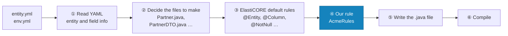
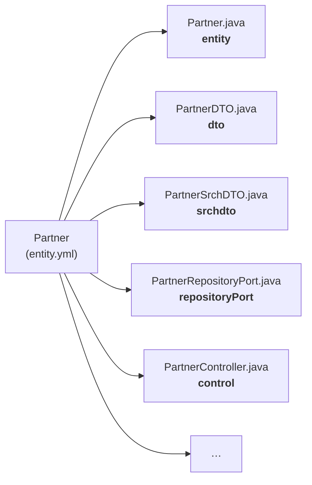
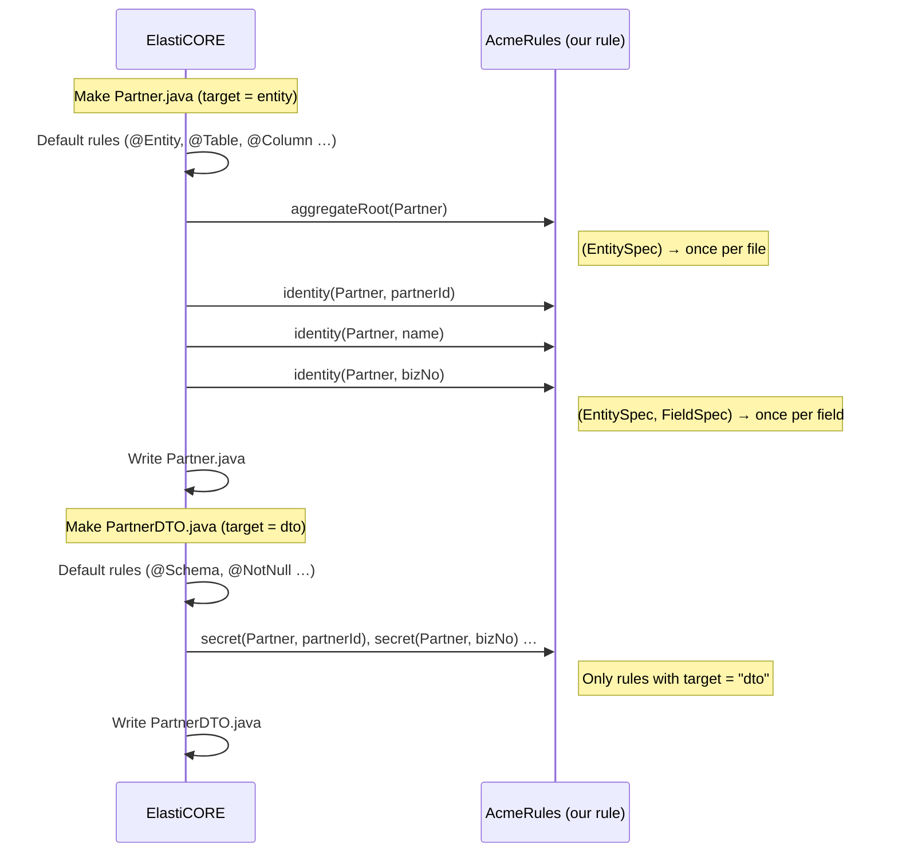
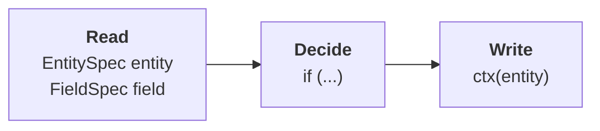
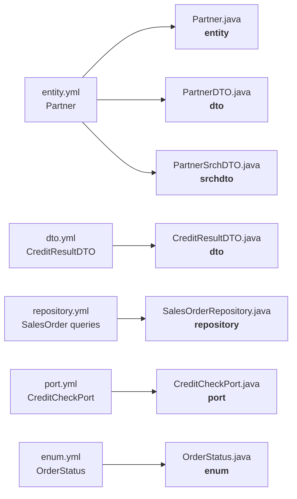

# ElastiCORE Rule Development Guide

ElastiCORE reads YAML (the DSL) and generates entity, DTO, service and controller code for you.
But every company wants something of its own. "Put our annotation on every entity", "this field must never go out in a response", and so on.

If you fix the generated files by hand every time, your changes vanish the next time you generate. Instead, create a **rule** once, and ElastiCORE applies it every time it generates code.
A rule is a plain Java class, and one method is one rule.

This document builds up the explanation by adding rules to a hexagonal ERP example project (Partner, Item, SalesOrder ...). All the code in the examples was actually built and tested.

| Chapter | What you learn | Result |
|---|---|---|
| 0 | When and where rules run (diagrams) | You understand the whole flow and where your code steps in |
| 1 | Create a place for rules | Your rules run during the build |
| 2 | Put an annotation on a class | `@AggregateRoot` on every root entity |
| 3 | Put an annotation on a field | `@Identity` on every identifier field |
| 4 | Create your own marker in YAML | `@secret` fields are left out of the API response |
| 5 | Stop a wrong model in the build | A rule violation fails the build |
| 6 | Apply rules to other YAML files too | `dto.yml`, search DTOs, `repository.yml` (SQL), `port.yml` (external integration), `enum.yml` |
| 7 | Test a rule | Check a rule quickly, without a project |
| 8, 9 | A complete rule class, the commonly used things | The full code to copy and start from, a one-page summary |
| 10 | Rule API reference | `@Rule`, `EntitySpec` and `FieldSpec`, `SourceCode` (`addMethod`, `excludeMethod`, `dontMake` ...), `AnnoCode`, `ModelCheck`, new files, `Syntax` |

---

## 0. When and where rules run

### The whole flow

When you run `./gradlew build`, ElastiCORE runs first, **before** compilation, and generates the Java files. Our rule steps in at ④ of that process.



- ③ and ④ repeat for **each file**. Once when it makes `Partner.java`, and again when it makes `PartnerDTO.java`.
- ④ always comes after ③. So our rule can remove what a default rule added, or add more on top of it.
- The file written in ⑤ is plain Java source. ⑥ is an ordinary compilation.

### Several files from one entity

Several files are generated from one entity (`Partner`) in the YAML. Each kind of file has a name, and this name is called the **target**. A rule decides "which target it applies to".



A rule with no target applies to `entity` (the entity class file).

### The order in which your method is called while one file is made

We never call a rule method. ElastiCORE calls it while it makes a file. How often it is called depends on the **shape of the method's parameters**.



### What happens inside a rule method: read, decide, write

Every rule has the same shape.



| Step | What you use | Example |
|---|---|---|
| Read | `EntitySpec entity` — the YAML information of the entity whose file is being made now | `entity.aggregateRoot()` |
| | `FieldSpec field` — the YAML information of one of its fields | `field.hasDsl("id")` |
| Decide | A plain Java `if` | `if (field.hasDsl("id"))` |
| Write | `ctx(entity)` — the Java file being made now | `ctx(entity).field(field).ensure(...)` |

`EntitySpec` and `FieldSpec` are a direct transcription of the YAML:

| YAML (`entity.yml`) | When you read it in a rule |
|---|---|
| `Partner:` | `entity.getName()` → `"Partner"` |
| `meta: entity @root @expose(20)` | `entity.aggregateRoot()` → `true`, `entity.hasMeta("expose")` → `true`, `entity.metaValue("expose")` → `"20"` |
| `partnerId: long @id @sequence` | `field.name()` → `"partnerId"`, `field.hasDsl("id")` → `true` |
| `bizNo: string(12)! @search(eq) @secret` | `field.required()` → `true`, `field.hasDsl("secret")` → `true`, `field.dslValue("search")` → `"eq"` |

What you write with `ctx(entity)` goes into the file at ⑤. ElastiCORE handles things in between, such as organizing imports and placing annotation lines.

These three diagrams are all of this document. From Chapter 1 on, we fill this flow with real code.

---

## 1. Create a place for rules

Put rules in a **different module** from the application. ElastiCORE generates code before it compiles the application, so the rules must already be compiled.

```
erp/
├── settings.gradle          ← add the module
├── build.gradle             ← connect the rules
├── acme-rules/              ← new module (any name)
│   ├── build.gradle
│   └── src/main/java/com/acme/rules/AcmeRules.java
└── src/ …                   ← existing application
```

**① Add one line to `settings.gradle`**:

```gradle
include 'acme-rules'
```

**② `acme-rules/build.gradle`** (new file):

```gradle
plugins {
    id 'java-library'
}

java { toolchain { languageVersion = JavaLanguageVersion.of(17) } }

repositories {
    mavenCentral()
}

dependencies {
    // Use the same ElastiCORE version as id 'io.elasticore' version in the root build.gradle
    compileOnly 'io.elasticore:elasticore-base:3.0.261031-rc7'

    testImplementation 'io.elasticore:elasticore-base:3.0.261031-rc7'
    testImplementation 'org.junit.jupiter:junit-jupiter:5.10.2'
    testRuntimeOnly 'org.junit.platform:junit-platform-launcher:1.10.2'
}

tasks.named('test') { useJUnitPlatform() }
```

**③ Add to two places in the root `build.gradle`**:

```gradle
elasticore {
    architecture = 'hexagonal'
    language     = 'java'
    rules        = ['com.acme.rules.AcmeRules']        // ← added: our rule class
}

dependencies {
    elasticore project(':acme-rules')                     // ← added: where ElastiCORE finds the rules
    implementation 'org.jmolecules:jmolecules-ddd:1.10.0'  // ← added: the annotations we attach in chapters 2-3
    // ... keep the existing dependencies
}
```

`elasticore project(':acme-rules')` means "use this module when generating code". It is not part of running the application.

**④ The rule class** — start with an empty class.

```java
package com.acme.rules;

import io.elasticore.base.model.pub.rules.CodeRules;

/** Our team's rules for the code ElastiCORE generates. */
public class AcmeRules implements CodeRules {
}
```

Now run `./gradlew build`. If it builds exactly as before, you are ready.

---

## 2. Put an annotation on a class

**What we want**: put jMolecules' `@AggregateRoot` on the aggregate root entities (in the ERP: Partner, Item, SalesOrder, Stock, Invoice).
(jMolecules is a library that marks "what role this class plays in DDD" with annotations. Architecture check tools read these marks.)

Add one method to `AcmeRules`.

```java
    /** Every aggregate root class gets @AggregateRoot. */
    @Rule("acme-aggregate-root")
    void aggregateRoot(EntitySpec entity) {
        if (entity.aggregateRoot()) {
            ctx(entity).ensureClassAnnotation(AnnoCode.of("org.jmolecules.ddd.annotation.AggregateRoot"));
        }
    }
```

Line by line:

| Code | Meaning |
|---|---|
| `@Rule("acme-aggregate-root")` | This method is a rule. The name in parentheses can be anything (give it your team's prefix so it does not collide with other rules) |
| `EntitySpec entity` | The **information of the entity** whose code is being made now. You read what you wrote in the YAML from here |
| `entity.aggregateRoot()` | Is this entity an aggregate root (not a member that belongs to another entity)? |
| `ctx(entity)` | The **Java file** being made now |
| `.ensureClassAnnotation(...)` | Puts the annotation on that class. The `import` is added for you |
| `AnnoCode.of("…AggregateRoot")` | The annotation to attach. Write it with the full name, including the package |

This method is called **once per entity**. The imports at the top of the file are as follows.

```java
import io.elasticore.base.model.pub.rules.AnnoCode;
import io.elasticore.base.model.pub.rules.CodeRules;
import io.elasticore.base.model.pub.rules.EntitySpec;
import io.elasticore.base.model.pub.rules.Rule;

import static io.elasticore.base.model.pub.rules.Ctx.ctx;
```

`Partner.java` generated after `./gradlew build`:

```java
@Entity
@Table(name = "erp_partner", ...)
@DynamicUpdate
@Getter
@Setter
@NoArgsConstructor
@EntityListeners(AuditingEntityListener.class)
@AggregateRoot                                   // ← added by our rule
public class Partner implements java.io.Serializable {
```

### It is also added to files that were already generated and that I edited

**Files where developers fill in code** such as `SalesOrder.java` (files with the `// Initially generated by ElastiCORE` line) are developer files, but rules still reach them.
If you have not touched the file, it is generated again according to the rules. If you edited it, the change is merged when the part the rule changes does not overlap the lines you edited (build log `MERGED(your edits kept)`).
So even if you add a rule later, the developer class of a generator-made root gets `@AggregateRoot`, and the methods the developer wrote stay as they are
(`elasticore-env-guide.md` 9-2).

If the developer also edited the line the rule changes, the file is left as it is (`KEPT(yours ...)`), and the build log tells you about the missing annotation.
The same applies to a file edited in a project with merging turned off (`merge = false`), and to a file made by a pre-merge version that was then edited (`SKIP(user-owned)`).
A file without the marker line is not reached by rules, and there is no notice either (`SKIP(no ElastiCORE header - yours)`). `SalesOrder.java`, `Stock.java` and
`Invoice.java` in the ERP example were copied whole from the hexagonal guide and have no marker line, so in a case like this you add it yourself:

```java
import org.jmolecules.ddd.annotation.AggregateRoot;

@AggregateRoot
@Entity
@Table(name = "erp_sales_order", ...)
public class SalesOrder extends SalesOrderBase {
```

---

## 3. Put an annotation on a field

**What we want**: put `@Identity` on the identifier (`@id`) field of every entity.

```java
    /** Every id field gets @Identity. */
    @Rule("acme-identity")
    void identity(EntitySpec entity, FieldSpec field) {
        if (field.hasDsl("id")) {
            ctx(entity).field(field).ensure(AnnoCode.of("org.jmolecules.ddd.annotation.Identity"));
        }
    }
```

There are two differences from chapter 2.

| | Chapter 2 | Chapter 3 |
|---|---|---|
| Method parameters | `(EntitySpec entity)` → once per entity | `(EntitySpec entity, FieldSpec field)` → once **per field** |
| Where it is attached | `ctx(entity).ensureClassAnnotation(...)` | `ctx(entity).field(field).ensure(...)` |

`field.hasDsl("id")` means "did you write `@id` on this field in the YAML?" (Add `FieldSpec` to the imports.)

Result:

```java
	@Id
	@GeneratedValue(strategy = GenerationType.IDENTITY)
	@Column(name = "partner_id")
	@Identity                                    // ← added by our rule
	private Long partnerId;
```

---

## 4. Create your own marker in YAML

**What we want**: when you write `@secret` on a field in the YAML, that field is **accepted in a request but not sent in the response** (for example, a business registration number).

**① Mark it in the YAML** — Partner in `model/entity.yml`:

```yaml
      bizNo:     string(12)! @search(eq) @secret   # business registration number, exact match when searching
```

`@secret` is a word ElastiCORE does not know. ElastiCORE does not treat an unknown word as an error. It only keeps it, so our rule can read it.

**② The rule** — this time we attach it not to the entity but to the **DTO** file.

```java
    /** A field marked @secret in the DSL is accepted in requests but never sent back in responses. */
    @Rule(value = "acme-secret", target = "dto")
    void secret(EntitySpec entity, FieldSpec field) {
        if (field.hasDsl("secret")) {
            ctx(entity).field(field).ensure(AnnoCode.of("com.fasterxml.jackson.annotation.JsonProperty")
                    .valRaw("access", "JsonProperty.Access.WRITE_ONLY"));
        }
    }
```

| Code | Meaning |
|---|---|
| `target = "dto"` | This rule runs when the **DTO file** is made. If you leave it out, it is `"entity"` (chapters 2 and 3) |
| `.valRaw("access", "JsonProperty.Access.WRITE_ONLY")` | An annotation attribute. Written as is, without quotes → `access = JsonProperty.Access.WRITE_ONLY` |
| (note) `.val("name", "x")` | A string attribute. Quotes are added for you → `name = "x"` |

Resulting `PartnerDTO.java`:

```java
	@Schema(description = "bizNo" , requiredMode=Schema.RequiredMode.REQUIRED )
	@NotNull
	@Size(max=12)
	@JsonProperty(access = JsonProperty.Access.WRITE_ONLY)   // ← added by our rule
	private String bizNo;
```

Now when you register a partner, `bizNo` is saved but is not in the response JSON.

### Which file a rule applies to - `target`

Write the kind of file in `target`. The commonly used ones:

| `target` | File that is made (ERP example) |
|---|---|
| `"entity"` (default) | The entity `Partner.java`. For a root split into two files, both `SalesOrderBase.java` and `SalesOrder.java` (class annotations). A method added with `addMethod` goes only into `SalesOrderBase.java` - `SalesOrder.java` inherits it. To add only to `SalesOrder.java`, use `target = "behavior"` |
| `"dto"` | `PartnerDTO.java` |
| `"srchdto"` | The search condition DTO `PartnerSrchDTO.java` |
| `"repository"` | `SalesOrderRepository.java`, which holds the queries from `repository.yml` |
| `"port"` | The external integration interface `CreditCheckPort.java` from `port.yml` |
| `"enum"` | `OrderStatus.java` from `enum.yml` |
| `"event"` | The domain event `SalesOrderShippedEvent.java` |
| `"repositoryPort"` | `PartnerRepositoryPort.java` |

Which file has which `target` is the first word of each line in the build log: `dto  src/main/java/.../PartnerDTO.java  WROTE`.
How to apply rules to `dto.yml`, `repository.yml`, `port.yml` and `enum.yml` is shown with examples in chapter 6.
The controller (`control`) and `XxxService` are also developer files, but rules still apply: if you have not touched them they are generated again, and if you edited them only changes that do not overlap the lines you edited are merged (the end of chapter 2).

---

## 5. Stop a wrong model in the build

A rule can also **only check**, without changing code.

**What we want**: a root that has business commands (`commands:`) must declare `@event`. If it does not, the build fails.

```java
    /** A root that takes commands must declare what it announces (@event). Otherwise the build fails. */
    @Rule("acme-commands-need-events")
    void commandsNeedEvents(EntitySpec entity) {
        if (!entity.commands().isEmpty() && entity.events().isEmpty()) {
            ModelCheck.fail(entity.getName() + " has commands but no @event. Add @event(...) to its meta.");
        }
    }
```

| Code | Meaning |
|---|---|
| `entity.commands()` | The list of commands written in the YAML `commands:` |
| `entity.events()` | The list of event names written in `@event(...)` |
| `ModelCheck.fail(message)` | Fails the build. Code generation runs to the end, then all the failure messages are collected, shown, and the build stops |
| `ModelCheck.warn(message)` | Only a warning (the build continues) |

If you delete `SalesOrder`'s `@event(...)` for a moment and build:

```
SalesOrder has commands but no @event. Add @event(...) to its meta.
[elcore3] the model check failed (1):
  SalesOrder has commands but no @event. Add @event(...) to its meta.
```

Do not throw an exception from a rule. Only that one file is not made, and the cause is hard to find.

---

## 6. Apply rules to other YAML files too (DTO, search, SQL, external integration, enum)

So far we applied rules to the entities in `entity.yml`. ElastiCORE's YAML also has `dto.yml`, `repository.yml`, `port.yml` and `enum.yml`, and you apply rules to **all of them in the same way**. Only two things change.

1. `target` - which file you apply it to
2. The **parameters** of the rule method - what you read



| YAML | File that is made (ERP example) | `target` | Rule method shape | What the rule reads |
|---|---|---|---|---|
| `entity.yml` | `Partner.java` | `"entity"` (default) | `(EntitySpec entity)`, `(EntitySpec entity, FieldSpec field)` | Entity, field |
| `entity.yml`, `dto.yml` | `PartnerDTO.java`, `CreditResultDTO.java` | `"dto"` | `(EntitySpec dto, FieldSpec field)` | DTO name, field |
| `@search(...)` on a field | `PartnerSrchDTO.java` | `"srchdto"` | `(EntitySpec search, FieldSpec field)` | Search field |
| `repository.yml` | `SalesOrderRepository.java` | `"repository"` | `(EntitySpec entity)` | `entity.queries()` — query methods |
| `port.yml` | `CreditCheckPort.java` | `"port"` | `(PortSpec port)` | `port.operations()` — external calls |
| `enum.yml` | `OrderStatus.java` | `"enum"` | `(EnumSpec enumeration)` | `enumeration.constants()` — values |

A DTO in `dto.yml` is also received as an `EntitySpec`. You read its name (`dto.getName()` → `"CreditResultDTO"`) and fields the same way as for an entity.

All five examples below are added as methods to the `AcmeRules` class from before.

### DTO (`dto.yml`) - hide internal fields from the API docs

**What we want**: when you write `@internal` on a `dto.yml` field, that field does not appear in the API docs (Swagger).

```yaml
  CreditResultDTO:                               # credit check result (response from the external system)
    meta: dto
    fields:
      bizNo:       string(12)
      grade:       string(2)
      creditLimit: bigdecimal(14.2) @internal     # internal use - hidden from the API docs
```

```java
    /** dto.yml: a field marked @internal is left out of the API docs. */
    @Rule(value = "acme-internal", target = "dto")
    void internal(EntitySpec dto, FieldSpec field) {
        if (field.hasDsl("internal")) {
            ctx(dto).field(field).merge(AnnoCode.of("io.swagger.v3.oas.annotations.media.Schema")
                    .val("hidden", true));
        }
    }
```

| Code | Meaning |
|---|---|
| `.merge(...)` | Only adds the attribute to an annotation that is **already there**. If there is none, it adds the annotation fresh |
| (compare) `.ensure(...)` | If the same annotation is already there, it **does nothing** |
| `.val("hidden", true)` | `hidden = true` (numbers and true/false without quotes) |

ElastiCORE already puts `@Schema(description = ...)` on DTO fields. So with `ensure` nothing happens, and you must use `merge` for `hidden = true` to be added.

Resulting `CreditResultDTO.java`:

```java
	@Schema(description = "creditLimit", hidden = true)   // ← hidden is added by our rule
	private BigDecimal creditLimit;
```

> Before you create your own marker, check whether ElastiCORE already has the same name. For example, `@example(A1)` is already turned into `@Schema(example="A1")` by ElastiCORE (`elasticore-annotation-guide.md`). If you delete your rule and the result stays the same, the feature already exists.

### Search DTO - a LIKE search needs 2 or more characters

**What we want**: when you search with a `@search(like)` field and enter just one character, the whole table gets scanned. Limit the search term to 2 or more characters.

```yaml
      name:      string(100)! @search(like)  # Partner in entity.yml
```

```java
    /** Search DTO: a LIKE search needs at least 2 characters, so nobody scans the whole table. */
    @Rule(value = "acme-like-min", target = "srchdto")
    void likeNeedsTwoCharacters(EntitySpec search, FieldSpec field) {
        if ("like".equals(field.dslValue("search"))) {
            ctx(search).field(field).ensure(AnnoCode.of("jakarta.validation.constraints.Size").val("min", 2));
        }
    }
```

Resulting `PartnerSrchDTO.java`:

```java
	@Schema(description = "Field matches pattern. field:name"  )
	@Size(min = 2)                                    // ← added by our rule
	private String name;
```

The search endpoint receives the request with `@Valid`, so a one-character search (`{"name":"A"}`) returns 400
(`"code":"invalid"`, and `fieldErrors` holds `{"field":"name","code":"Size"}`). If you have already edited the controller,
check that `search(@Valid @RequestBody ...)` has the `@Valid` - controllers generated before 3.0.261027-rc2 do not have it.

### SQL (`repository.yml`) - read queries are read-only, `SELECT *` is forbidden

**What we want**: two things.
- Among the methods where you wrote a query directly in `repository.yml`, a **read (SELECT)** runs in a read-only transaction.
- `SELECT *` is stopped in the build (because it breaks silently when a column changes).

```yaml
repository:
  SalesOrder:                                     # the key is the entity name
    methods:
      - id: summarizeByPartner
        params:
          status: OrderStatus
        return: List<PartnerSalesDTO>
        query: "SELECT o.partner.partnerId AS partnerId, o.partner.name AS partnerName,
                COUNT(o) AS orderCount, SUM(o.totalAmount) AS totalAmount
                FROM SalesOrder o WHERE o.status = :status
                GROUP BY o.partner.partnerId, o.partner.name"
```

```java
    /** repository.yml: a query that only reads runs in a read-only transaction. "SELECT *" is refused. */
    @Rule(value = "acme-queries", target = "repository")
    void queries(EntitySpec entity) {
        for (QuerySpec query : entity.queries()) {
            if (query.sql() == null) continue;      // Spring Data makes it from the method name
            if (query.sql().toLowerCase().replaceAll("\\s+", " ").contains("select *")) {
                ModelCheck.fail(entity.getName() + "." + query.name() + ": name the columns instead of SELECT *");
            }
            if (query.isSelect()) {
                ctx(entity).method(query.name()).ensure(
                        AnnoCode.of("org.springframework.transaction.annotation.Transactional").val("readOnly", true));
            }
        }
    }
```

| Code | Meaning (YAML) |
|---|---|
| `entity.queries()` | The list of methods written in `repository.yml` for this entity |
| `query.name()` | `id:` → `"summarizeByPartner"` |
| `query.sql()` | The `query:` string. `null` if there is none (a method made from its name alone) |
| `query.isSelect()` | Is it a read query? (`false` for UPDATE and DELETE) |
| `query.isNative()` | Did you write DB SQL directly with `nativeQuery: true`? |
| `query.returnType()`, `query.params()` | `return:`, `params:` |
| `ctx(entity).method("name").ensure(...)` | An annotation on the **method** of that name. If several methods have the same name, on all of them |

Resulting `SalesOrderRepository.java`:

```java
    @Query(nativeQuery=false, value=" SELECT o.partner.partnerId AS partnerId, ...")
    @Transactional(readOnly = true)                   // ← added by our rule
    List<PartnerSalesDTO> summarizeByPartner(@Param("status") OrderStatus status);
```

ElastiCORE also adds the import (`org.springframework.transaction.annotation.Transactional`).
If you write a method name wrongly, the file is left as it is and the build log tells you: `[rule] method 'summarize' is not declared in SalesOrderRepository (repository file); its annotations were not written`.

### External integration (`port.yml`) - mark external calls

**What we want**: mark the interface that calls an external system, and its methods, with "which system and which address it calls". Monitoring and audit logs read this mark.

```yaml
port:
  CreditCheckPort:                               # external credit rating system
    meta: http @url("https://credit.example.com/api") @timeout(connect=2000, read=5000)
    methods:
      checkCredit:
        meta: method @get("/partners/{bizNo}/credit")
        params:
          bizNo: string
        return: CreditResultDTO
```

You create the two annotations used as marks directly in the application (`src/main/java/com/acme/erp/support/`):

```java
@Retention(RetentionPolicy.RUNTIME)
@Target(ElementType.TYPE)
public @interface ExternalSystem { String value(); }     // ExternalCall uses ElementType.METHOD
```

```java
    /** port.yml: every HTTP call is marked with the system and the endpoint it reaches. */
    @Rule(value = "acme-external-call", target = "port")
    void externalCall(PortSpec port) {
        ctx(port).ensureClassAnnotation(AnnoCode.of("com.acme.erp.support.ExternalSystem").value(port.getName()));
        for (PortSpec.Operation op : port.operations()) {
            if (op.url() != null) {
                ctx(port).method(op.name()).ensure(AnnoCode.of("com.acme.erp.support.ExternalCall")
                        .value(op.httpMethod() + " " + op.url()));
            }
        }
    }
```

| Code | Meaning (YAML) |
|---|---|
| `(PortSpec port)` | Runs once per port. There are no fields, so there is no `FieldSpec` shape |
| `port.getName()` | `CreditCheckPort` |
| `port.protocol()` | `meta: http` → `"http"`, `"dbms"` for a DB port |
| `port.url()` | `@url(...)` |
| `port.operations()` | The `methods:` list |
| `op.name()`, `op.httpMethod()`, `op.url()` | `checkCredit`, `GET`, `/partners/{bizNo}/credit` |
| `op.returnType()`, `op.params()` | `return:`, `params:` |
| `.value("...")` | An unnamed attribute → `@ExternalSystem("CreditCheckPort")` |

Resulting `CreditCheckPort.java`:

```java
@ExternalService(protocol="http", id="erp.CreditCheckPort" ,url="https://credit.example.com/api", connectTimeout=2000, readTimeout=5000)
@ExternalSystem("CreditCheckPort")                        // ← our rule
public interface CreditCheckPort   {

    @HttpEndpoint(url="/partners/{bizNo}/credit", method="GET", contentType="application/json", paramNames="bizNo")
    @ExternalCall("GET /partners/{bizNo}/credit")         // ← our rule
    CreditResultDTO checkCredit(String bizNo);
}
```

### enum (`enum.yml`) - describe an enum once in the API docs

**What you want**: In the Swagger docs, the value list of an enum is not repeated wherever the enum is used. It is defined once and referenced.

```java
    /** enum.yml: every enum is described once in the API docs and referenced from there. */
    @Rule(value = "acme-enum-schema", target = "enum")
    void enumSchema(EnumSpec enumeration) {
        ctx(enumeration).ensureClassAnnotation(AnnoCode.of("io.swagger.v3.oas.annotations.media.Schema")
                .val("enumAsRef", true));
    }
```

| Code | Meaning (YAML) |
|---|---|
| `enumeration.getName()` | `OrderStatus` |
| `enumeration.constants()` | The values under `enum:`. For each value, `c.name()` -> `"DRAFT"`, `c.values()` -> `["DRF", "Draft"]` |
| `enumeration.fields()` | `fields:` (`code`, `label`) |

The resulting `OrderStatus.java`:

```java
@Schema(enumAsRef = true)          // ← our rule
@Getter
public enum OrderStatus {
```

### What goes where - check it in one step

Run `./gradlew elcore3 -PlistRules` to get the list of rules that run for each file kind (`target`). If the five rule names above (`acme-internal`, `acme-like-min`, `acme-queries`, `acme-external-call`, `acme-enum-schema`) appear under their own `target`, they are connected.

---

## 7. Testing rules

Checking with a full build every time is slow. Inside the rule module you can **build a small model by hand** and run only the rules.

**`acme-rules/src/test/java/com/acme/rules/AcmeRulesTest.java`**

```java
package com.acme.rules;

import io.elasticore.base.model.pub.rules.EntitySpec;
import io.elasticore.base.model.pub.rules.EnumSpec;
import io.elasticore.base.model.pub.rules.ModelCheck;
import io.elasticore.base.model.pub.rules.PortSpec;
import io.elasticore.base.model.pub.rules.RuleCatalog;
import io.elasticore.base.model.pub.rules.RuleEngine;
import io.elasticore.base.model.pub.rules.SourceCode;
import org.junit.jupiter.api.AfterEach;
import org.junit.jupiter.api.Test;

import java.util.Collections;

import static org.junit.jupiter.api.Assertions.assertEquals;
import static org.junit.jupiter.api.Assertions.assertTrue;

/** Our rules, run on a small model written in the test. */
class AcmeRulesTest {

    // The same set the project uses: the hexagonal bundle plus our rules.
    private final RuleEngine engine = RuleCatalog.standard().engineFor("hexagonal-springboot")
            .register(new AcmeRules())
            .templateSet(SourceCode.TemplateSet.V3);

    // Like writing in entity.yml:
    //   Partner:
    //     meta: entity @root
    //     fields:
    //       partnerId: long @id
    //       bizNo:     string(12)! @secret
    private EntitySpec partner() {
        return new EntitySpec("Partner")
                .domain("erp", "Erp")
                .meta("root", "")
                .pkg("entity", "com.acme.erp.domain.model")
                .pkg("dto", "com.acme.erp.application.dto")
                .field("partnerId", "long @id")
                .field("bizNo", "string(12)! @secret");
    }

    @AfterEach
    void clear() {
        ModelCheck.reset();
    }

    @Test
    void entity() {
        String code = engine.run(partner(), "entity").render();
        assertTrue(code.contains("@AggregateRoot"), code);
        assertTrue(code.contains("@Identity"), code);
    }

    @Test
    void dto() {
        String code = engine.run(partner(), "dto").render();
        assertTrue(code.contains("@JsonProperty(access = JsonProperty.Access.WRITE_ONLY)"), code);
    }

    @Test
    void commandsWithoutEvents() {
        EntitySpec order = new EntitySpec("SalesOrder").domain("erp", "Erp").meta("root", "")
                .field("orderId", "string(36) @id")
                .addCommand("confirm", Collections.emptyList());
        engine.run(order, "entity");
        assertEquals(1, ModelCheck.failures().size());
    }

    // Like writing in dto.yml:
    //   CreditResultDTO:
    //     meta: dto
    //     fields:
    //       creditLimit: bigdecimal(14.2) @internal
    @Test
    void dtoYml() {
        EntitySpec credit = new EntitySpec("CreditResultDTO").domain("erp", "Erp")
                .pkg("dto", "com.acme.erp.application.dto")
                .field("creditLimit", "bigdecimal(14.2) @internal");
        String code = engine.run(credit, "dto").render();
        assertTrue(code.contains("hidden = true"), code);
    }

    @Test
    void searchDto() {
        EntitySpec partner = partner().field("name", "string(100)! @search(like)");
        String code = engine.run(partner, "srchdto").render();
        assertTrue(code.contains("@Size(min = 2)"), code);
    }

    // Like writing in repository.yml:
    //   SalesOrder:
    //     methods:
    //       - id: summarize
    //         return: List<Object[]>
    //         query: "SELECT o.status, COUNT(o) FROM SalesOrder o GROUP BY o.status"
    @Test
    void repository() {
        EntitySpec order = new EntitySpec("SalesOrder").domain("erp", "Erp")
                .pkg("entity", "com.acme.erp.domain.model")
                .pkg("repository", "com.acme.erp.infrastructure.persistence")
                .field("orderId", "string(36) @id")
                .query("summarize", "List<Object[]>", "SELECT o.status, COUNT(o) FROM SalesOrder o GROUP BY o.status");
        String code = engine.run(order, "repository").render();
        assertTrue(code.contains("@Transactional(readOnly = true)"), code);
    }

    @Test
    void selectStarIsRefused() {
        EntitySpec order = new EntitySpec("SalesOrder").domain("erp", "Erp")
                .field("orderId", "string(36) @id")
                .nativeQuery("everything", "List<Object[]>", "SELECT * FROM erp_sales_order");
        engine.run(order, "repository");
        assertEquals(1, ModelCheck.failures().size());
    }

    // Like writing in port.yml:
    //   CreditCheckPort:
    //     meta: http @url("https://credit.example.com/api")
    //     methods:
    //       checkCredit:
    //         meta: method @get("/partners/{bizNo}/credit")
    //         params:
    //           bizNo: string
    //         return: CreditResultDTO
    @Test
    void port() {
        PortSpec port = new PortSpec("CreditCheckPort", "erp").protocol("http")
                .url("https://credit.example.com/api")
                .pkg("port", "com.acme.erp.application.port.out");
        port.operation("checkCredit", "CreditResultDTO").param("String", "bizNo")
                .endpoint("/partners/{bizNo}/credit", "GET", null);
        String code = engine.run(port, "port").render();
        assertTrue(code.contains("@ExternalSystem(\"CreditCheckPort\")"), code);
        assertTrue(code.contains("@ExternalCall(\"GET /partners/{bizNo}/credit\")"), code);
    }

    @Test
    void enumeration() {
        EnumSpec status = new EnumSpec("OrderStatus").constant("DRAFT", "DRF", "Draft")
                .pkg("enumeration", "com.acme.erp.domain.model");
        String code = engine.run(status, "enum").render();
        assertTrue(code.contains("@Schema(enumAsRef = true)"), code);
    }
}
```

| Code | Meaning |
|---|---|
| `new EntitySpec("Partner").meta("root", "")` | `Partner:` in YAML + `meta: entity @root` |
| `.field("bizNo", "string(12)! @secret")` | One YAML field line, as it is |
| `new EntitySpec("CreditResultDTO").field("creditLimit", "bigdecimal(14.2) @internal")` | A DTO from `dto.yml` works the same way |
| `.query("summarize", "List<Object[]>", "SELECT ...")` | One method of `repository.yml` (`nativeQuery(...)` is `nativeQuery: true`) |
| `new PortSpec("CreditCheckPort", "erp").protocol("http")` + `port.operation(...)` | A port and its methods from `port.yml` |
| `new EnumSpec("OrderStatus").constant("DRAFT", "DRF", "Draft")` | An enum and its values from `enum.yml` |
| `engine.run(model, "dto").render()` | Builds the DTO file for that model and returns it **as a string**. `"repository"`, `"port"` and `"enum"` work the same way |
| `System.out.println(code)` | To see the result, just print it. You see the whole file that would be generated |

```bash
./gradlew :acme-rules:test
```

---

## 8. The finished rule class

```java
package com.acme.rules;

import io.elasticore.base.model.pub.rules.AnnoCode;
import io.elasticore.base.model.pub.rules.CodeRules;
import io.elasticore.base.model.pub.rules.EntitySpec;
import io.elasticore.base.model.pub.rules.EnumSpec;
import io.elasticore.base.model.pub.rules.FieldSpec;
import io.elasticore.base.model.pub.rules.ModelCheck;
import io.elasticore.base.model.pub.rules.PortSpec;
import io.elasticore.base.model.pub.rules.QuerySpec;
import io.elasticore.base.model.pub.rules.Rule;

import static io.elasticore.base.model.pub.rules.Ctx.ctx;

/** Our team's rules for the code ElastiCORE generates. */
public class AcmeRules implements CodeRules {

    /** Every aggregate root class gets @AggregateRoot. */
    @Rule("acme-aggregate-root")
    void aggregateRoot(EntitySpec entity) {
        if (entity.aggregateRoot()) {
            ctx(entity).ensureClassAnnotation(AnnoCode.of("org.jmolecules.ddd.annotation.AggregateRoot"));
        }
    }

    /** Every id field gets @Identity. */
    @Rule("acme-identity")
    void identity(EntitySpec entity, FieldSpec field) {
        if (field.hasDsl("id")) {
            ctx(entity).field(field).ensure(AnnoCode.of("org.jmolecules.ddd.annotation.Identity"));
        }
    }

    /** A field marked @secret in the DSL is accepted in requests but never sent back in responses. */
    @Rule(value = "acme-secret", target = "dto")
    void secret(EntitySpec entity, FieldSpec field) {
        if (field.hasDsl("secret")) {
            ctx(entity).field(field).ensure(AnnoCode.of("com.fasterxml.jackson.annotation.JsonProperty")
                    .valRaw("access", "JsonProperty.Access.WRITE_ONLY"));
        }
    }

    /** A root that takes commands must declare what it announces (@event). Otherwise the build fails. */
    @Rule("acme-commands-need-events")
    void commandsNeedEvents(EntitySpec entity) {
        if (!entity.commands().isEmpty() && entity.events().isEmpty()) {
            ModelCheck.fail(entity.getName() + " has commands but no @event. Add @event(...) to its meta.");
        }
    }

    /** dto.yml: a field marked @internal is left out of the API docs. */
    @Rule(value = "acme-internal", target = "dto")
    void internal(EntitySpec dto, FieldSpec field) {
        if (field.hasDsl("internal")) {
            ctx(dto).field(field).merge(AnnoCode.of("io.swagger.v3.oas.annotations.media.Schema")
                    .val("hidden", true));
        }
    }

    /** Search DTO: a LIKE search needs at least 2 characters, so nobody scans the whole table. */
    @Rule(value = "acme-like-min", target = "srchdto")
    void likeNeedsTwoCharacters(EntitySpec search, FieldSpec field) {
        if ("like".equals(field.dslValue("search"))) {
            ctx(search).field(field).ensure(AnnoCode.of("jakarta.validation.constraints.Size").val("min", 2));
        }
    }

    /** repository.yml: a query that only reads runs in a read-only transaction. "SELECT *" is refused. */
    @Rule(value = "acme-queries", target = "repository")
    void queries(EntitySpec entity) {
        for (QuerySpec query : entity.queries()) {
            if (query.sql() == null) continue;      // Spring Data makes it from the method name
            if (query.sql().toLowerCase().replaceAll("\\s+", " ").contains("select *")) {
                ModelCheck.fail(entity.getName() + "." + query.name() + ": name the columns instead of SELECT *");
            }
            if (query.isSelect()) {
                ctx(entity).method(query.name()).ensure(
                        AnnoCode.of("org.springframework.transaction.annotation.Transactional").val("readOnly", true));
            }
        }
    }

    /** port.yml: every HTTP call is marked with the system and the endpoint it reaches. */
    @Rule(value = "acme-external-call", target = "port")
    void externalCall(PortSpec port) {
        ctx(port).ensureClassAnnotation(AnnoCode.of("com.acme.erp.support.ExternalSystem").value(port.getName()));
        for (PortSpec.Operation op : port.operations()) {
            if (op.url() != null) {
                ctx(port).method(op.name()).ensure(AnnoCode.of("com.acme.erp.support.ExternalCall")
                        .value(op.httpMethod() + " " + op.url()));
            }
        }
    }

    /** enum.yml: every enum is described once in the API docs and referenced from there. */
    @Rule(value = "acme-enum-schema", target = "enum")
    void enumSchema(EnumSpec enumeration) {
        ctx(enumeration).ensureClassAnnotation(AnnoCode.of("io.swagger.v3.oas.annotations.media.Schema")
                .val("enumAsRef", true));
    }
}
```

---

## 9. Common things

**Reading from an entity** (`EntitySpec entity`)

| Code | Meaning |
|---|---|
| `entity.getName()` | The entity name `Partner` |
| `entity.aggregateRoot()` | Is it a root |
| `entity.hasMeta("expose")` / `entity.metaValue("expose")` | Does the meta have `@expose` / the value in its parentheses |
| `entity.fields()` | The list of fields |
| `entity.commands()`, `entity.events()` | Business commands, events |
| `entity.config("acme.x")` | The value of `elasticore.config.acme.x` in `env.yml` (when you want to give a team setting to a rule) |

**Reading from a field** (`FieldSpec field`)

| Code | Meaning |
|---|---|
| `field.name()`, `field.typeName()` | Name, type |
| `field.hasDsl("secret")` / `field.dslValue("length")` | Is `@secret` there / the `200` of `@length(200)` |
| `field.required()` | Is it marked required with `!` |

**Reading from other YAML files** (chapter 6)

| Code | Meaning |
|---|---|
| `entity.queries()` -> `query.name()`, `sql()`, `isSelect()`, `isNative()` | A method of `repository.yml` (target `"repository"`) |
| `port.getName()`, `port.protocol()`, `port.operations()` -> `op.name()`, `op.httpMethod()`, `op.url()` | `port.yml` (target `"port"`, method shape `(PortSpec port)`) |
| `enumeration.getName()`, `enumeration.constants()` | `enum.yml` (target `"enum"`, method shape `(EnumSpec enumeration)`) |

**Writing to the code** (`ctx(entity)`)

| Code | Meaning |
|---|---|
| `ensureClassAnnotation(AnnoCode.of("a.b.C"))` | An annotation on the class (not added twice if it is already there) |
| `removeClassAnnotation("a.b.C")` | Remove an annotation from the class (also one that is added by default) |
| `field(field).ensure(AnnoCode.of("a.b.C"))` | An annotation on a field |
| `field(field).removeAnnotation("a.b.C")` | Remove an annotation from a field |
| `field(field).merge(AnnoCode.of("a.b.C").val("x", "y"))` | Add attributes to an annotation that is already there (adds the annotation if it is missing) |
| `method("name").ensure(AnnoCode.of("a.b.C"))` | An annotation on a method (query method, port method and so on) |

Pass `ctx(...)` exactly what the rule received: `ctx(entity)`, `ctx(dto)`, `ctx(port)`, `ctx(enumeration)`.

**When something goes wrong**

| Symptom | What to check |
|---|---|
| `Rule set class '…' is not on the generator's classpath` | The `rules` class name in the root `build.gradle`, and `elasticore project(':acme-rules')` |
| You do not know whether a rule runs | `./gradlew elcore3 -PlistRules` - it lists the rules that run for each file kind. If you see your rule names, they are connected |
| You do not see the result | Whether that file is logged as `KEPT` or `SKIP` in the build log (end of chapter 2), and whether the `target` is right (table in chapter 4, table in chapter 6). In the chapter 7 test, check the result with `println` |
| The generated code looks wrong | Print `engine.run(...).render()` as in chapter 7 and check the rule on its own |

You do not need to care about the order in which rules run. Our rules always run **after** the ElastiCORE default rules, so what you add or remove stays.

---

## 10. Rule API reference

All types are in the package `io.elasticore.base.model.pub.rules`. This section lists only what team rules use. The other public
methods are used by ElastiCORE's own rules and can change between versions.

```java
import io.elasticore.base.model.pub.rules.*;
import static io.elasticore.base.model.pub.rules.Ctx.ctx;
```

### `@Rule` attributes and method shapes

`CodeRules` is a marker interface with no method to implement, and each method annotated with `@Rule` is one rule. The method is `void`,
and the class needs a constructor with no arguments.

| Attribute | Default | Meaning |
|---|---|---|
| `value` | (required) | The rule id. It shows in `-PlistRules` and is used in `suppress`. Add a team prefix (`acme-…`) |
| `target` | `"entity"` | The file kind the rule contributes to (table in chapter 4, chapter 6) |
| `order` | `0` | Within the same phase, smaller first. If equal, registration order |
| `phase` | `HEAD` | Whether a file-level rule runs before (`HEAD`) or after (`TAIL`) the field rules. Meaningless for field rules |

| Parameter | Called | Example `target` |
|---|---|---|
| `(EntitySpec e)` | Once each time the file of that entity is built | `entity`, `dto`, `srchdto`, `repository`, `control`, `service`, `behavior` |
| `(EntitySpec e, FieldSpec f)` | Once for each field of that file | `entity`, `dto`, `srchdto` |
| `(DomainSpec d)` | Once for each domain-level file | `mapper`, `apiErrors`, domain files you create yourself |
| `(EnumSpec e)` | Once for each enum | `enum` |
| `(PortSpec p)` | Once for each external integration port | `port` |
| `(ProtoServiceSpec p)` | Once for each proto port | `proto` |

Within one file, the order is `HEAD` file rules -> field rules (for each field) -> `TAIL` file rules.

### `EntitySpec` - an entity, a DTO from `dto.yml`, a search DTO

| Method | In the DSL |
|---|---|
| `getName()`, `domainName()`, `domainClassName()` | The entity name, the domain (`"erp"`, `"Erp"`) |
| `hasMeta("x")`, `metaValue("x")`, `metaValues("x")` | `@x` in `meta:`, the value of `@x(value)`, all values when written several times |
| `metaText("access")` | The original text of a paired value such as `@access(read=public, update=owner)` |
| `aggregateRoot()`, `containedIn()` | Is it a root / for a member, the name of its root |
| `isSplitForBehavior(e.getName())` | Is it a root split into two files (`XxxBase` + a developer class) |
| `fields()`, `allFields()`, `dtoFields()`, `pkFields()` | Own fields / including inherited / DTO side / identifiers |
| `events()`, `eventClassName(ev)`, `eventPackage()` | The names in `@event(...)`, the name and package of the generated event class |
| `commands()` -> `name()`, `params()` | The business commands in `commands:` |
| `queries()` -> `name()`, `sql()`, `isSelect()`, `isNative()`, `returnType()`, `params()` | The methods of `repository.yml` (target `repository`). For a query made from the method name, `sql()` is `null` |
| `pkg("dto")` | The package of an `env.yml` namespace key |
| `config("acme.maxPageSize")` | `elasticore.config.acme.maxPageSize` in the `env.yml` of that domain, `null` if missing |
| `tablePrefix()`, `apiPath()` | `config.table.prefix`, `config.apiPath` |

### `FieldSpec` - one field line

| Method | In the DSL |
|---|---|
| `name()`, `capitalName()` | The field name, and the form for accessors (`"email"`, `"Email"`) |
| `typeName()`, `coreItemType()` | The declared type / the `X` of `List<X>` |
| `required()` | `!` |
| `hasDsl("x")`, `hasDslAny("x", "y")` | Is `@x` there (case-insensitive) |
| `dslValue("x")`, `dslValueAny(...)` | The value of `@x(value)` - `dslValue("search")` -> `"like"` |
| `dslProperty("onetomany", "mappedBy")` | A named attribute such as `@OneToMany(mappedBy="parent")` |
| `maxLength()` | `string(100)` or `@length` (0 if none) |
| `description()` | The description after `--` |
| `label()` | The `--` description, or `@label` if there is none |
| `dbColumnName()` | `@column` or the snake_case name |
| `isList()`, `isEntityRef()`, `isBaseType()`, `isStringType()` | Collection / reference to another entity / basic type / string |
| `isMoney()`, `isDate()`, `isDateTime()` | `money`, `date`, `datetime` |

`DomainSpec`: `getName()`, `className()`, `entities()`, `namespace("event")` (`null` if missing), `config("a.b")`, `isOn("a.b")`.
`EnumSpec`: `getName()`, `constants()` -> `name()`, `values()`, `fields()`.
`PortSpec`: `getName()`, `protocol()`, `url()`, `operations()` -> `name()`, `httpMethod()`, `url()`, `returnType()`, `params()`.

### `SourceCode` - the file being built now, returned by `ctx(spec)`

| Method | What it does |
|---|---|
| `ensureClassAnnotation(anno)` | A class annotation. Not added twice if it is already there. Imports are automatic |
| `removeClassAnnotation(fqcn)` | Remove a class annotation (also one that a default rule added) |
| `field(f)` -> `FieldCode` | The declaration of that field |
| `removeField(f)` | Remove that field from this file |
| `method("name").ensure(anno)` | An annotation on every method with that name (`repository`, `port` …). If the name does not exist, the build log shows a notice |
| `addMethod(source)` | Add a hand-written method at the end of the class (before the closing brace) |
| `excludeMethod("deleteById", …)` | Remove an endpoint method from the generated controller (below) |
| `addImport(fqcn)` | Register an import (only the ones actually used are rendered) |
| `dontMake()` | Do not create this file (the log shows `SKIP(dontMake)`) |
| `var(k, v)`, `varLine(k, fmt, args…)`, `varLines(k, list)` | Fill the `${k}` of the skeleton / add a line. `null` is ignored - use `""` for an empty value |
| `syntax()`, `requireSyntaxAnyOf(ruleId, Syntax…)` | The language of this file / fails the file if it is used to generate another language |
| `render()`, `unfilledSlots()` | In tests: the whole file as a string / the names of the `${…}` that were not filled |

`addMethod` puts the method body in exactly as the rule wrote it, so it depends on the language - to use it in a Kotlin project too, branch on `ctx(e).syntax()`.
In a root split into two files (`SalesOrderBase` + the developer's `SalesOrder`), the methods of an entity rule go only into `SalesOrderBase`,
and the developer class inherits them. To add to the developer class only, write it with `@Rule(target = "behavior")` - it applies only when the file is first generated.
In 3.0.261022-rc1, `addMethod` is dropped on a class with no methods at all, and it is added once more to the developer class.
In rc1, add the member with `ctx(e).field(id).after("…")` in a field rule.

`excludeMethod` names and endpoints:

| Name | Endpoint |
|---|---|
| `create` | `POST /` |
| `read` | `GET /{id}` |
| `search` | `POST /search` |
| `update`, `batchUpdate` | `PUT /`, `PUT /batch` |
| `deleteById`, `deleteBatch` | `DELETE /{id}`, `POST /delete` |
| `schemaInfo` | `GET /schema/info` |

In v3 output (`hexagonal`, `ddd`, Kotlin), removing `deleteById` also removes `deleteBatch`, and removing `update` also removes `batchUpdate`.
The 2.x-compatible bundle (`jpa-springboot`) removes only the names you list, so list both, as in `excludeMethod("deleteById", "deleteBatch")`. Use it **only on the controller** (`target = "control"`):
the use case port of hexagonal is built before team rules, so removing a method from the service (`service`) leaves `XxxService implements
XxxUseCase` uncompilable. To remove it from the service and the port as well, use `@restExclude(deleteById)` in the DSL. The controller is
a developer file, so this does not apply to a controller that has already been edited.

### `FieldCode` - one field

| Method | What it does |
|---|---|
| `ensure(anno)` | Adds the annotation only if the same one is not there (usually this one) |
| `add(anno)` | Always adds it (for repeatable annotations) |
| `merge(anno)` | Adds only the attributes to the same annotation that is already there, adds the annotation if missing (use it to add to the `@Schema`, `@Column` of the default rules) |
| `replace(anno)` | Replaces the same annotation with this one |
| `removeAnnotation(fqcn)` | Remove it |
| `type("String")`, `rename("x")`, `initial("0")` | The declared type / the name / the initial value |
| `comment(fmt, …)`, `before(fmt, …)`, `after(fmt, …)` | A comment / a line above the declaration / a member after the declaration (calling it several times continues the lines) |

### `AnnoCode` - an annotation

Do not build an annotation by joining strings. `AnnoCode` handles the Java (`{}`) and Kotlin (`[]`) syntax, imports and quotes.
The annotation class does not need to be on the generator's classpath - the application needs it when it compiles.

| Code | Result |
|---|---|
| `AnnoCode.of("jakarta.persistence.Column")` | `@Column` + import |
| `AnnoCode.of("org.jmolecules.ddd.annotation.%s", "Identity")` | Build the name with a format |
| `.val("name", "user_id")` | `name = "user_id"` (a string - quotes are added) |
| `.val("hidden", true)`, `.val("min", 2)` | `hidden = true`, `min = 2` |
| `.valRaw("access", "JsonProperty.Access.WRITE_ONLY")` | As it is - constants, class literals |
| `.valRaw("length", "%d", 200)` | A format |
| `.value("x")`, `.valueRaw("A.B")` | An unnamed attribute - `@X("x")`, `@X(A.B)` |
| `.qualified()` | With the full name (when it clashes with `jakarta.persistence.Entity`) |
| `AnnoCode.AnnoList.of(...)` | A list of annotations such as `indexes = {...}` |

### `ModelCheck` - checks

| Method | Result |
|---|---|
| `ModelCheck.warn(msg)` | A warning only. The same message appears once |
| `ModelCheck.fail(msg)` | Generation runs to the end, then all failures are collected and shown, and the build fails (`elcore3` exit code 1) |
| `ModelCheck.failures()`, `ModelCheck.reset()` | Check the result in a test / reset between tests |

Do not throw an exception in a rule. Only the one file that rule was writing is left as a failure, and the cause is hard to find.

### New files - `ArtifactContributor`

| Type | What it does |
|---|---|
| `ArtifactContributor` -> `artifactsFor(EntitySpec e)` | Declares a file for each entity |
| `DomainArtifactContributor` -> `artifactsFor(DomainSpec d)` | Declares a file for each domain |
| `ContributedArtifact.of(target, namespaceKey, className)` | The new target name (= the skeleton name), the package key, the class name |
| `.orNamespace("entity")` | The key to use in a project that does not have that package key |

The skeleton is `src/main/resources/elasticore-template/v3/<target>.tmpl` (Java) in the rule module, and
`elasticore-template/kt/<target>.tmpl` (Kotlin). For an example, see `elasticore-ddd-customize-guide.md`.

### `Syntax` - the language seam

The generator writes annotations and imports for the language, so team rules usually need no language branch. Only when you write code fragments yourself (lines of a new file,
`addMethod`), branch with `ctx(e).syntax()` or ask `Syntax`:

| Call | Java | Kotlin |
|---|---|---|
| `s.statement("return x")` | `return x;` | `return x` |
| `s.getter("dto", "name")` | `dto.getName()` | `dto.name` |
| `s.setter("to", "name", "v")` | `to.setName(v)` | `to.name = v` |
| `s.localVar("T", "x", "init")` | `T x = init;` | `val x = init` |
| `s.newInstance("X", "")` | `new X()` | `X()` |
| `s.nullableType("String")` | `String` | `String?` |
| `s.classLiteral("X")` | `X.class` | `X::class` |

Team rules are added only to server (Java, Kotlin) generation and do not go into the TypeScript client.

---

## Learn more

- **Rules that create new files** (for example, a message topic constant class for each event), turning off default output, reading team settings, Kotlin: `elasticore-ddd-customize-guide.md`
- The full rule API: `elasticore-rule-guide.md`
