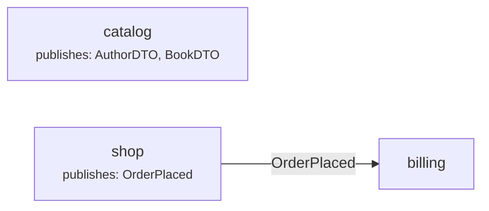

<!-- Generated by ElastiCORE from config.context in each env.yml - do not edit. -->
# Context map

An arrow points from the context that is used (upstream) to the one that uses it.

| Context | Uses | Publishes |
|---|---|---|
| billing | shop |  |
| catalog |  | AuthorDTO, BookDTO |
| shop |  | OrderPlaced |
